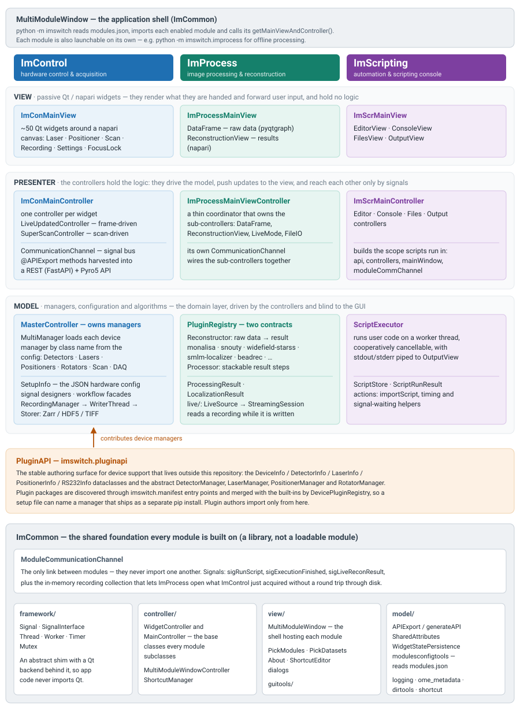

************
Architecture
************

How the ImSwitch2 code base is organised and how its parts find each other.
This page describes patterns and points at the code; it deliberately does not
list every widget, controller, manager or processor, because those lists are
the registries and directories themselves.  For the model-view-presenter
overview and its diagram see :ref:`architecture-at-a-glance` on the home page.

         presenter and model layers, with the PluginAPI and ImCommon
         underneath.
   :width: 100%
   :target: _images/architecture-overview.svg

   Modules, MVP layers, PluginAPI and ImCommon.

.. contents::
   :local:
   :depth: 2

Package layout
==============

Everything lives under ``imswitch/``:

.. list-table::
   :header-rows: 1
   :widths: 18 82

   * - Package
     - Role
   * - ``imcommon``
     - Shared library, not a loadable module.  ``framework`` (Qt shim),
       ``controller`` (base classes, ``ModuleCommunicationChannel``,
       ``MultiModuleWindowController``, ``ShortcutManager``), ``view``
       (``MultiModuleWindow``, shared dialogs, ``guitools``), ``model``
       (``APIExport``/``generateAPI``, ``WidgetStatePersistence``,
       ``dirtools``, ``modulesconfigtools``, logging, shutdown state, OME
       metadata) and ``algorithms`` (Qt-free image algorithms such as ROI
       handling, segmentation, tile mosaics and bead fitting).
   * - ``imcontrol``
     - Hardware control and acquisition.  Launchable alone with
       ``python -m imswitch.imcontrol``.
   * - ``improcess``
     - Image processing and reconstruction.  Launchable alone with
       ``python -m imswitch.improcess``.
   * - ``imscripting``
     - Script editor, console and runner.  Cannot run on its own: its
       ``__main__`` raises an error, because scripts need the other modules.
   * - ``pluginapi``
     - The stable import surface for device plugins that live outside this
       repository (see `Device plugins`_).
   * - ``_data``
     - Shipped data: ``user_defaults`` (copied into the user's config folder)
       and bundled libraries.

A package is a *module* in the application sense when its ``__init__`` sets
``__imswitch_module__ = True`` and defines ``__title__`` and
``getMainViewAndController(moduleCommChannel, ...)``, which returns the
module's main view and main controller.
``imcommon.model.modulesconfigtools.getAvailableModules`` finds modules by
scanning ``imswitch`` for that marker.  Modules never import one another; the
only route between them is ``ModuleCommunicationChannel`` (see
`Signal buses`_).

The ``imcommon.framework`` package is a thin shim: abstract ``Signal``,
``SignalInterface``, ``Thread``, ``Worker``, ``Timer`` and ``Mutex`` in
``base.py`` with the Qt implementations in ``qt.py``.  Application code
imports these names from ``framework`` instead of from Qt.

Application startup
===================

``python -m imswitch`` runs ``imswitch/__main__.py``:

#. Parse ``--debug`` and ``--scale``, set up logging (including the log file
   under the user config folder) and create the ``QApplication``.
#. Read the enabled module ids from ``config/modules.json`` in the user config
   folder (``modulesconfigtools.getEnabledModuleIds``).  ``imscripting`` is
   always moved to the end of the list: its script scope snapshots the
   controllers of the modules loaded before it.
#. Import each enabled module, create one ``ModuleCommunicationChannel``, and
   show a ``MultiModuleWindow`` with a loading screen.
#. Call each module's ``getMainViewAndController``.  A module that raises is
   replaced by a ``ModuleLoadErrorView`` tab and the others continue.
#. Hand the main controllers to ``launchApp``, which runs the Qt event loop and
   the shutdown sequence.

ImControl's ``getMainViewAndController`` (``imswitch/imcontrol/__init__.py``)
then:

#. Loads ``imcontrol_options.json`` (``Options``).  If it did not exist, or
   its setup file is missing, a ``PickSetupDialog`` asks for a setup file.
#. Loads the chosen setup JSON into ``ViewSetupInfo`` (a ``SetupInfo``
   subclass that adds view-only fields such as ``availableWidgets``) and
   applies the per-machine memory limits from the options.
#. Builds ``ImConMainView(options, setupInfo)``, which creates one dock and
   widget per entry in ``availableWidgets``.
#. Builds ``ImConMainController`` (see below).

Model, view, controller in ImControl
====================================

Every module follows the same split.  In ImControl:

**Model.**  ``imcontrol/model`` holds ``SetupInfo`` (configuration),
``managers/`` (hardware abstraction and the recording and scan managers),
``signaldesigners/``, ``plugins/`` (device plugin registry), ``devices/``
(read-only device status and an opt-in lifecycle service), ``workflows/``
and ``timeresolved/`` (headless workflows behind a narrow facade),
``configeditor/`` (schema extraction and catalogs behind the config editor)
and ``interfaces/`` (vendor drivers and their mocks).

**View.**  ``imcontrol/view/widgets`` holds the widgets.  They derive from
``Widget`` or ``NapariHybridWidget`` (``basewidgets.py``) and are passive:
they render and emit signals.  ``widgets/__init__.py`` exports them lazily by
name, and ``ImConMainView`` instantiates ``<Key>Widget`` for every key in the
setup's ``availableWidgets``.  The scan widget is the one exception to the
naming rule: its class is ``ScanWidget<scanWidgetType>``.

**Controller.**  ``imcontrol/controller/controllers`` holds one controller per
widget, named ``<Key>Controller``.  ``ImConMainController`` loops over the
widgets that exist, looks up the class by that name (again
``ScanController<scanWidgetType>`` for the scan) and creates it through
``ImConWidgetControllerFactory``, which passes every controller the same four
things: ``setupInfo``, the ``MasterController``, the ``CommunicationChannel``
and the ``ModuleCommunicationChannel``.  A few controllers have no widget
(for example ``WorkflowFacadeController``) and are created the same way.

Base classes in ``imcontrol/controller/basecontrollers.py``:

* ``ImConWidgetController`` -- the root of all of them.
* ``LiveUpdatedController`` -- controllers that receive every new frame
  through ``update``.
* ``SuperScanController`` -- the common base of the scan controllers; it
  also mixes in ``ScanLifecycleMixin`` (see :doc:`scan-lifecycle`).
* ``StatefulComponentMixin`` -- opt-in widget-state persistence (see
  `Widget state persistence`_).

Controller methods decorated with ``@APIExport`` become the scripting and
remote API (see `Scripting`_).

MasterController and managers
=============================

``MasterController`` (``imcontrol/controller/MasterController.py``) is built
once from the ``SetupInfo`` and owns every manager.  It first creates the
*low-level* managers that several devices can share: ``NidaqManager``,
``RS232sManager`` and, when configured, the pulse generator and the
TriggerScope manager.  These are passed to every per-device manager as the
``**lowLevelManagers`` keyword dictionary, so a laser that needs a serial port
looks it up by key instead of creating its own.

Then it creates one *group manager* per device family -- ``DetectorsManager``,
``LasersManager``, ``PositionersManager``, ``RotatorsManager``,
``FlipMirrorsManager``, ``SLMsManager`` -- plus ``RecordingManager``, the stand
manager when ``microscopeStand`` is set, and one scan manager chosen by
``scan.scanWidgetType`` (``Base``, ``Advanced`` or ``TriggerScope``; the
retired ``PointScan`` and ``MoNaLISA`` types stop startup with a pointer to
their replacement).  Finally it forwards manager signals onto the
``CommunicationChannel`` (for example ``detectorsManager.sigImageUpdated`` to
``sigUpdateImage``) and builds the device status supervisor.  ``closeEvent``
finalizes the managers in a fixed order.

The group managers derive from ``MultiManager``
(``imcontrol/model/managers/MultiManager.py``).  Its constructor walks the
device map of the setup (``setupInfo.detectors``, ``setupInfo.lasers``, ...),
resolves each device's ``managerName`` to a class and instantiates it as
``ManagerClass(deviceInfo, name, **lowLevelManagers)``.  Vendor SDKs are
imported lazily inside the manager modules, and several managers fall back to
a mock when the SDK or device cannot be opened, so a setup can start without
the hardware; each fallback is logged (see :doc:`devices/plugins` for how
plugins should make that choice visible).  The abstract base classes per family
(``DetectorManager``, ``LaserManager``, ``PositionerManager``,
``RotatorManager``, ...) live beside the concrete managers in
``imcontrol/model/managers/<family>/``.  To add a device see
:doc:`adding-device-support`; the low-level manager keys are listed under
:ref:`available-low-level-managers`.

Device plugins
==============

``MultiManager`` does not import managers by path any more; it asks the
``DevicePluginRegistry`` (``imcontrol/model/plugins/registry.py``) first.  The
registry merges two sources:

* an explicit table of built-in contributions
  (``plugins/builtins.py``), and
* contributions discovered from installed packages through the
  ``imswitch.manifest`` entry point (``plugins/discovery.py``), each described
  by a JSON manifest (``plugins/manifest.py``).

Resolution order for a ``managerName`` is: registry (by id or alias), then the
legacy in-tree import path ``imswitch.imcontrol.model.managers.<family>``, then
an actionable ``UnknownDeviceManagerError`` that lists what is installed and
names the pip package for managers that were moved out
(``plugins/external.py``).  A built-in contribution cannot be overridden by a
plugin; a plugin that shares a name with an in-tree manager found only through
the legacy path shadows it and a warning is logged.  The registry is built once
per process on first use.  Plugin authors import only from
``imswitch.pluginapi`` (the device info dataclasses and the abstract
``DetectorManager``, ``LaserManager``, ``PositionerManager`` and
``RotatorManager``).  The user guide is :doc:`devices/plugins`.

This is a separate system from ImProcess' registry of reconstructors and
processors (see `ImProcess`_).

Signal buses
============

There are two buses, at two levels.

**CommunicationChannel** (``imcontrol/controller/CommunicationChannel.py``) is
the signal bus *inside* ImControl.  It declares plain ``Signal`` attributes for
the acquisition, recording, scan, SLM and event-triggered workflows
(``sigUpdateImage``, ``sigAcquisitionStarted``, ``sigRecordingEnded``,
``sigScanStarting`` ... ``sigScanEnded``, ...) and is the only thing
controllers use to reach each other.  It also carries small helpers that need
the controller registry, such as the *active scan source* used by
:doc:`scan-lifecycle`, and two service objects, ``scanWorkflow`` and
``beadRecWorkflow``, that group the calls for those workflows.  Its class
docstring is explicit that it is a compatibility surface: new cross-controller
workflows should use scoped service objects rather than more signals.

Its public scripting entry point is ``signals()``, an ``@APIExport`` method
that returns a read-only object holding the signals scripts may wait on:
``acquisitionStarted``, ``acquisitionStopped``, ``recordingStarted``,
``recordingEnded``, ``recordingFailed``, ``scanStarting``, ``scanStarted``,
``scanDone``, ``scanEnded``, ``scanRejected`` and ``saveFocus``.  Use it as
``api.imcontrol.signals().scanEnded`` with ``getWaitForSignal`` or
``callAndWaitForSignal`` (:doc:`scripting`).  The names exposed there are the
stable contract; the underlying ``sigX`` attributes are internal.

**ModuleCommunicationChannel**
(``imcommon/controller/ModuleCommunicationChannel.py``) is the only link
*between* modules.  It has three signals -- ``sigRunScript``,
``sigExecutionFinished`` and ``sigLiveReconResult`` -- tracks which modules
are registered, and holds ``memoryRecordings``, a ``VFileCollection`` of
recordings kept in memory.  ImControl's ``MasterController`` puts a finished
in-memory recording there so that ImProcess can open it without a trip through
disk.  ImProcess has a ``CommunicationChannel`` of its own
(``improcess/controller/CommunicationChannel.py``) for its sub-controllers.

Scan design
===========

Scanning splits into *designing* signals and *running* them.

**Signal designers** (``imcontrol/model/signaldesigners``) turn scan
parameters into waveforms.  Two base classes in ``basesignaldesigners.py``:
``ScanDesigner`` (analog waveforms for galvos and stages) and
``TTLCycleDesigner`` (digital on/off patterns for lasers and detectors).
The setup's ``scan`` block names them: ``scanDesigner`` and
``TTLCycleDesigner`` are class names that ``SignalDesignerFactory`` imports
from that package by name, together with ``scanDesignerParams`` and
``TTLCycleDesignerParams``.  The scan geometry (image
dimensions, pixel sizes, samples per pixel, dwell time) travels with the
signals as a ``ScanInfoContract`` dictionary, validated by
``validate_scan_info_contract``, so downstream code reads it instead of
recomputing it.

**Scan managers** (``imcontrol/model/managers/ScanManager*.py``, derived from
``SuperScanManager``) own one scan family.  They create the designers from the
setup, check that incoming parameters fit them
(``_parameterCompatibility``), and build the full waveform set in
``makeFullScan``.  A scan the designer refuses (too long, outside a scanner's
voltage range) raises an error that carries the reason.

**Scan controllers** (``ScanController<type>``, on ``SuperScanController``)
collect parameters from the widget, ask the scan manager for signals, hand
them to the execution backend and publish the ``sigScan*`` lifecycle signals.  The
detector-lease coordination that decides which detectors take part is in
``managers/_scan_execution.py``.  The lifecycle, abort and recording coupling
are in :doc:`scan-lifecycle`; the advanced geometry is in
:doc:`advanced-scanning`.

.. _pulse-generator-subsystem:

Pulse generator subsystem
=========================

Digital pulse generators sit behind an abstract
``PulseGeneratorManager`` (``imcontrol/model/managers/pulsegen``) so that
consumers do not depend on one vendor.  The implementations are
``PulseStreamerManager`` (Swabian Pulse Streamer) and ``TeensyPulseManager``
(a Teensy on a serial port; with ``useMockOnFailure`` it falls back to a mock driver).  The base class
declares capability properties -- ``jitter_ns``, ``min_pulse_width_ns``,
``n_digital_channels``, ``supports_hw_trigger_in``, ``supports_analog`` and
``connected`` -- so a consumer can inspect what it was given, and the
operations ``setDigital``, ``setAnalog``, ``program_sequence`` (a list of
``PulseStep``), ``run``, ``stop`` and ``snap``, plus ``sigSequenceStarted``,
``sigSequenceDone`` and ``sigSequenceFailed``.  ``MasterController`` builds the
Teensy manager when ``teensyPulse`` is set and injects it as the
``pulseGeneratorManager`` low-level manager.  To add a backend see
:doc:`how-to/add-pulse-generator-backend`; for the Teensy see
:doc:`how-to/wire-teensy`.

Recording data path
===================

``RecordingManager`` (``imcontrol/model/managers/RecordingManager.py``) takes
frames from the ``DetectorsManager`` and writes them to disk:

* ``RecordingWorker`` hands frames to a ``WriterThread``, so disk I/O and
  compression stay off the acquisition thread; the writer's queue is bounded
  to apply back-pressure.
* A ``Storer`` subclass owns one file format: ``ZarrStorer``, ``HDF5Storer`` or
  ``TiffStorer`` (selected through ``SaveFormat`` and ``DEFAULT_STORER_MAP``).
* All three write standard OME metadata from one description,
  ``OmeImageMeta`` (``imcommon/model/ome_metadata.py``): OME-TIFF, OME-NGFF
  0.5 for Zarr, and HDF5 with Fiji element sizes plus embedded OME-XML.  The
  recording-specific axis layout per recording mode is in
  ``managers/recording_metadata.py``.  ImProcess writes its results through
  the same class, so a recording and a reconstruction describe their axes and
  scales the same way.
* Streaming storers set a ``recording:frames_committed`` attribute only after
  the data it counts has been flushed, so a reader of a file that is still
  being written (the live reconstruction below) never sees unwritten chunks.
* Per-recording attributes (session notes, acquisition layout, completion
  outcome) travel in shared attributes (``SharedAttributes``) and end up as an
  OME annotation, in all three formats.

The layout of the HDF5 and Zarr output is described in :doc:`Hdf5datafile`.

ImProcess
=========

``improcess`` is organised around two plugin contracts and a result type:

* ``Reconstructor`` (``reconstructors/base.py``) turns one raw dataset
  (``DataObj``) into a ``ProcessingResult``.  A ``StreamingReconstructor`` can
  additionally consume frames incrementally (see below).
* ``Processor`` (``processors/base.py``) turns a result into new results; any
  number can be stacked.  Each processor declares which result *kinds* it
  accepts, so the GUI only offers steps that apply to the selected result.
* Results (``improcess/model``) are image or array results
  (``ProcessingResult`` and subclasses) or table-backed ones such as
  ``LocalizationResult`` for single-molecule data.

Both kinds of plugin are registered by id in a ``PluginRegistry``
(``reconstructors/registry.py``, reached through ``get_registry()``).
Controllers look plugins up by id and never import them.  At start-up
``ImProcessMainController._initialize_plugins`` first loads the user's drop-in
plugins, then registers the built-in reconstructors and processors that the
setup file's ``processing`` block names, or a standalone default set when
there is none.  The built-ins are the tables in
``reconstructors/__init__.py`` and ``processors/__init__.py``; to see what the
installed version has, run::

    python -m imswitch.improcess.workflows list

**Drop-in plugins** (``improcess/plugins``).  A single ``.py`` file in the
user plugins folder that defines ``Processor`` or ``Reconstructor`` subclasses
is discovered, loaded tolerantly (a broken file is logged and skipped) and
joins the same registries; built-in ids win a collision.
``plugins/plugin_store.py`` is a Qt-free client for an online index of such
files.  See :doc:`improcess-napari-plugins` for the napari side.

**Workflows** (``improcess/workflows``).  A workflow is an ordered list of
steps (sources, reconstructions, processing steps, saves) that runs through
the same code paths as the GUI, from a terminal or a script, with batch
and replay support.  See :doc:`improcess-workflows`.

**Analysis** (``improcess/analysis``) holds the Qt-free computations behind the
processors and panels (FRC, projections, segmentation, colocalization, ROI
measurements, SMLM rendering, ...).

**Live reconstruction** (``improcess/live``).  A ``LiveSource`` reads a Zarr or
HDF5 recording while ImControl is still writing it (the
``frames_committed`` barrier above), including time-lapse layouts spread over
several files; ``make_live_source`` picks the right one.  ``LiveStreamWorker``
and ``LiveProcessWorker`` feed a ``StreamingSession`` created by a
``StreamingReconstructor``, and results go back to the GUI through
``sigLiveReconResult``.

**Controllers and views.**  ``ImProcessMainViewController`` is a thin
coordinator that owns sub-controllers (data frame, reconstruction view,
file I/O, live mode, ...), wired over ImProcess' own ``CommunicationChannel``.
The raw-data pane and the napari-based results viewer are separate views; the
results list is the registry of produced results, and tool panels act on the
selected one (see :doc:`improcess`).  Which dock panels exist is configured by
the ``processing`` block read through ``model/processing_config.py``.
Further developer notes are in ``imswitch/improcess/README.md``.

Scripting
=========

**API generation.**  ``generateAPI`` (``imcommon/model/api.py``) takes a list
of objects, collects every method marked ``@APIExport`` and returns one object
holding them.  Names must be unique across the objects.
``@APIExport(runOnUIThread=True)`` marks methods that touch Qt objects: they
are wrapped so that a call from another thread runs on the GUI thread and
returns its result or re-raises its exception.  ``ImConMainController``
builds the ImControl API from all widget controllers, the setup-mode
controller, the ``CommunicationChannel`` and ``WorkflowFacadeController``; the
result is ``controller.api``.  When ``pyroServerInfo.active`` is set in the
setup file the same object is also served by ``ImSwitchServer`` (FastAPI and
Pyro5).  Because the API is built from the widgets a setup loads, a method is
only present when the widget that defines it is in ``availableWidgets``.  The
reference pages in ``docs/api`` are generated from the decorators by
``tools/generateapidocs.py``.

**Running scripts.**  ``ImScrMainController`` builds the *script scope*: ``api``
(the ``controller.api`` of every loaded module that has one), ``controllers``
(every module's main controller), ``mainWindow``, ``moduleCommChannel`` and the
global helpers from ``imscripting/model/actions.py`` (``sleep``,
``getWaitForSignal``, ``callAndWaitForSignal``, ``runScanAndWait``,
``importScript``, ...).  ``ScriptExecutor`` runs the script on an
``ExecutionThread`` worker so the GUI stays responsive, supports cooperative
cancellation, and routes ``stdout`` and ``stderr`` to the output view.  Because
a script can reach controllers, shutdown first closes the API gate and drains
the script thread before ImControl finalizes hardware.  The user-level
description is in :doc:`scripting`.

Configuration
=============

**Setup file.**  The hardware is described by one JSON file per setup in
``~/ImSwitchConfig/imcontrol_setups/`` (``imcontrol/model/SetupInfo.py``).
``SetupInfo`` is a ``dataclasses_json`` dataclass tree: top-level sections
(``detectors``, ``lasers``, ``positioners``, ``rs232devices``, ``scan``,
``pyroServerInfo``, ...) map device names to per-device info dataclasses that
carry a ``managerName`` and free-form ``managerProperties``.  Unknown
top-level keys are kept in a catch-all instead of failing, which is how
module-specific blocks such as ImProcess' ``processing`` travel in the same
file.  Field reference: :doc:`setupinfo-reference`; introduction:
:doc:`imcontrol-setups`.

**User folder.**  ``imcommon/model/dirtools.py`` defines the folders:
an ``ImSwitchConfig`` folder in the user directory (``UserFileDirs``) and the shipped
``imswitch/_data`` (``DataFileDirs``).  The files in ``_data/user_defaults``
(example setups, ``config/modules.json``, scripts, ImProcess snippets) are
copied into the user folder on the first import of ``imswitch``; a later
version updates the copies that the user has not edited and keeps edited ones.
Because this sync runs on import, tests and scratch scripts should set a
throwaway ``HOME``.  ``config/`` holds ``modules.json`` and
``imcontrol_options.json``.

**Config editor.**  ``imcontrol/view/configeditor`` is the graphical editor
for setup files; ``imcontrol/model/configeditor`` holds the model side:
``managerProperties`` schemas extracted from the manager sources, role rules,
and the catalogs behind the typed fields.  The setup validator
(``python -m imswitch.imcontrol.model.plugins validate-setup``) uses the same
schemas.

.. _widget-state-persistence:

Widget state persistence
========================

Controllers that want their settings restored at the next start derive from
``StatefulComponentMixin`` (``imcontrol/controller/basecontrollers.py``) and
implement four methods:

* ``getComponentState()`` -- a JSON-serialisable snapshot;
* ``applyComponentState(state, *, applyMode)`` -- restore it and return a list
  of warnings instead of raising for recoverable problems;
* ``describeComponentState(state)`` -- a human-readable summary;
* ``getComponentStateHazards(state, *, applyMode)`` -- anything dangerous in a
  saved state, such as a high laser power.

``applyMode`` (``ComponentStateApplyMode``) says which actions are allowed.
``STARTUP_RESTORE`` is a passive restore of values and settings and must not
start emission or motion; ``SETUP_MODE_APPLY`` is the explicit application of
a named setup mode.  The component, not the caller, enforces the policy.
Class attributes (``componentName``, ``legacyStateNames``,
``stateSchemaVersion``, the ``setupModeApplyPriority`` bands) describe how the
component is named, versioned and ordered.

The registry is ``WidgetStatePersistence`` in
``imcommon/model/WidgetStatePersistence.py``, shared by every module and
reached through ``getWidgetStatePersistence()`` (``imcontrol.model`` re-exports
it).  A controller registers itself under its canonical name; legacy names
resolve through an alias table.  Files are written below
``~/ImSwitchConfig/imcontrol_widget_states/<component>/<state>.json``.
``ImConMainController`` restores the ``default`` state once all controllers
exist and, after asking, saves it on close; menu actions ("Save Widget
States" and "Load Widget States") export and import all states as one file.  ``SetupModeController`` uses the same
component contract to apply named setup modes.  Settings that the setup file
owns (for example ``cameraPixelSizeUm``) are not restored over the file's
value.  The full contract -- apply modes, which components activate hardware
only in a setup mode, file formats, aliases -- is on :doc:`state-persistence`.
