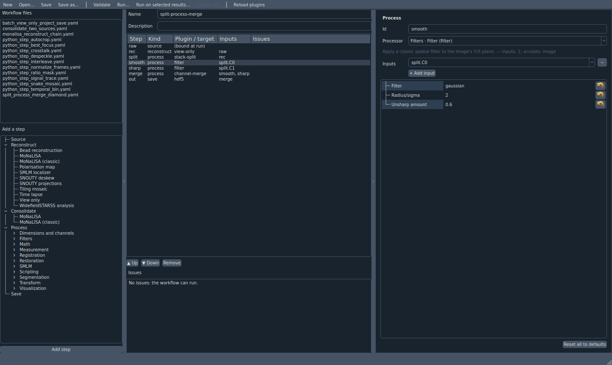
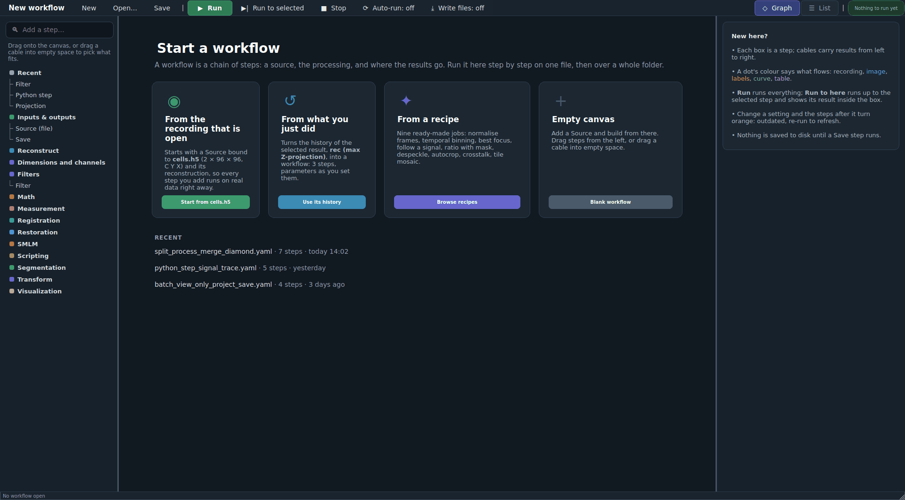
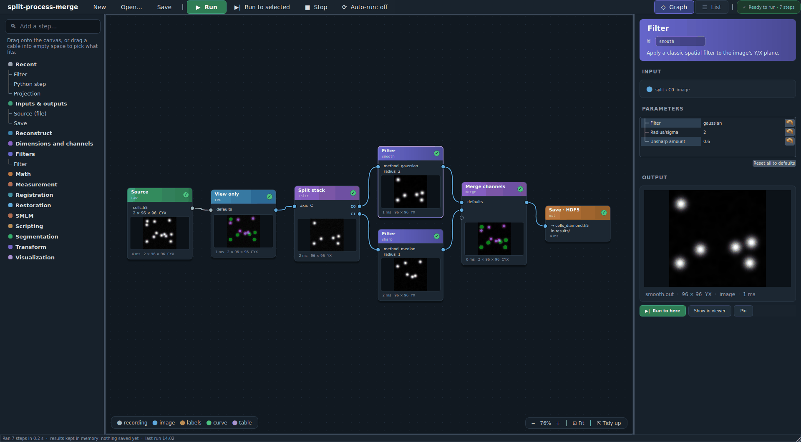
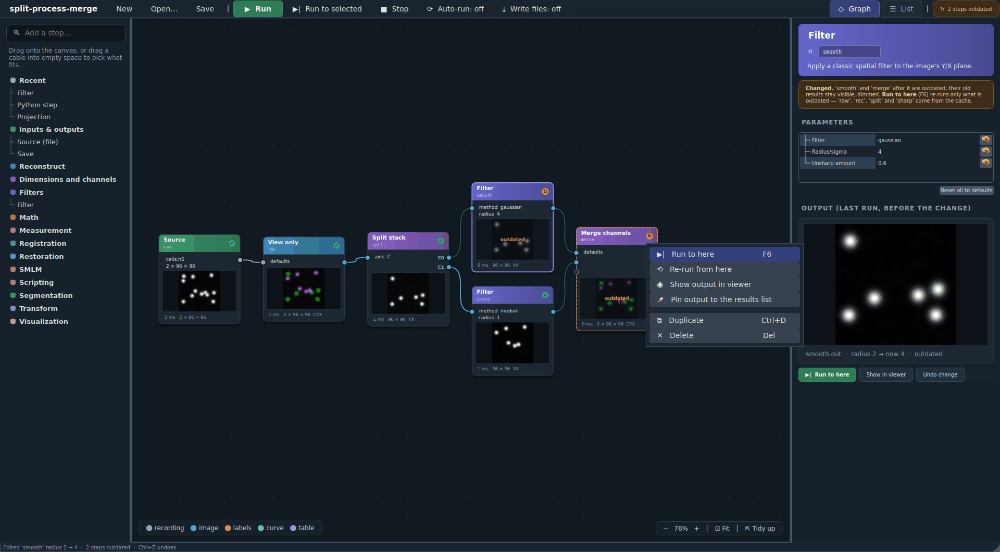
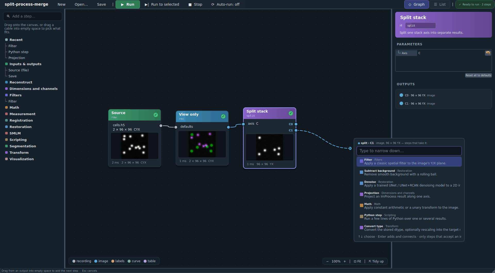
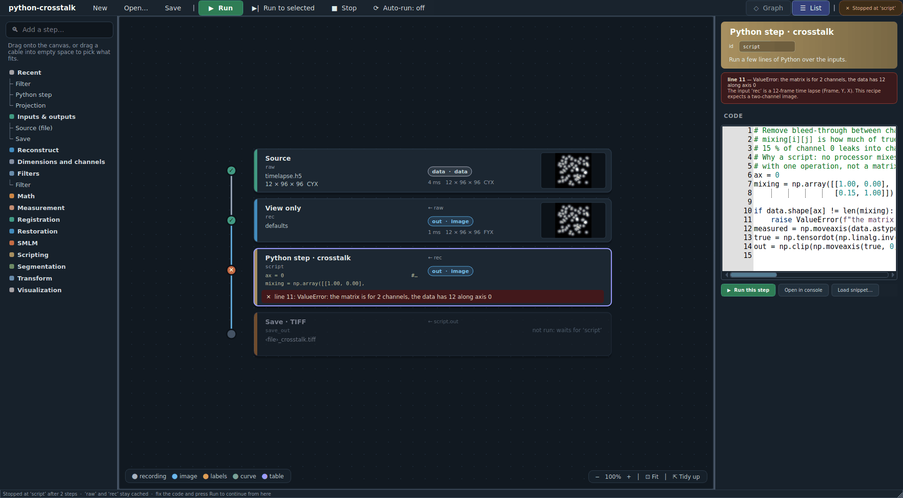
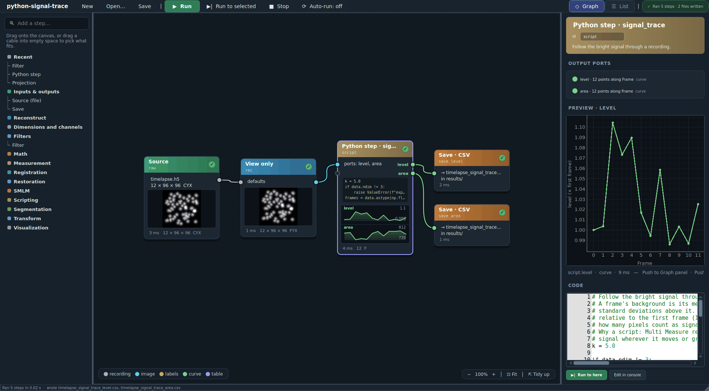

# ImProcess Workflow Editor 2.0: a patcher canvas and interactive runs

Date: 2026-10-24 (revision 4, after three review rounds)

Status: **Phases 0–3 implemented** (2026-10-25): kinds and runner extensions
(Phase 0), the canvas and inspector (Phase 1), interactive runs with the
cache, previews, Show in viewer and Pin (Phase 2), the start page, list
cards, auto-run, frames and the docs with screenshots of the real editor
(Phase 3); every exit item is covered by headless tests except Phase 3's
check with two people who have not used the editor, which is still to do.
An independent review of the implementation (2026-10-25) found eleven
defects (among them previews that decoded the whole recording, a file a
running plan reads closed by an edit made meanwhile, typing written over an
undo); each is fixed and has a regression test that fails without the fix.
Phase 4 is to be decided now that Phase 3 has shipped. Three independent
review rounds on 2026-10-24 approved the plan (see *Review record*). The
mockups below are renders of the spike that preceded the editor
(`tools/workflow_editor_2_mockups/`, removed once the real editor could
render its own: `docs/images/workflow-editor/`, made by
`tools/workflow_editor_screenshots.py`); the spike used the real plugin
catalogue, the real `WorkflowDocument` and real run results, and the window
around them was the proposal. Supersedes the "graph canvas" item of Phase 4
in `improcess-workflow-editor.md`.

**Decisions taken** (2026-10-24): the graph is the default mode, with the list
one click away and the choice remembered; interactive previews stay in the
editor until *Show in viewer* (temporary) or *Pin* (permanent); auto-run is off
by default; Phase 4 is decided after Phase 3 ships.

## Summary

Today's editor has every capability a workflow needs, but it shows a workflow
as a table of text and a form. A branching workflow's shape is only readable
in the *Inputs* column (`split.C0`, `smooth, sharp`), a port is a string in a
combo box, and running sends the results somewhere else: nothing in the editor
shows what a step produced.

The proposal, in four lines:

- **A patcher canvas** (after FL Studio's Patcher, Blender's node editor and
  ComfyUI): every step is a box with inputs on the left and outputs on the
  right; cables carry results; a port's colour says what flows (recording,
  image, labels, curve, table). A **list mode** shows the same document as a
  pipeline of cards, one click away.
- **Interactive runs inside the editor**: *Run*, *Run to here*, a per-step
  status, timing and a thumbnail of each step's output in its box, a large
  preview in the inspector. Changing a parameter marks that step and everything
  after it **outdated** and the next run re-runs only those; the rest comes
  from a cache.
- **Immediately understandable**: a start page (from the open recording, from
  a result's history, from a recipe, blank), a searchable palette, a
  "drag a cable into empty space" picker that offers only steps that accept
  what the cable carries, and plain words for every state.
- **Feasible without changing the workflow file format.** The runner can
  already start from in-memory results and skip what only fed them, which is
  the core of cached re-runs; positions and other view state go under
  `Workflow.metadata["editor"]`, which round-trips and which the runner
  ignores. New code is a canvas (custom `QGraphicsScene`, no new dependency),
  a Qt-free run session with a result cache that owns the files its results
  read from, and five small runner and document extensions.

## 1. What is hard about today's editor



*Today: `examples/improcess_workflows/split_process_merge_diamond.yaml`, step
`smooth` selected, in ImSwitch's own theme.*

Observed on the shipped examples:

1. **The shape is hidden.** The diamond (split → two filters → merge) reads as
   seven rows; who feeds whom is in the *Inputs* text. Fan-out, fan-in and
   unused outputs are invisible.
2. **Ports are strings.** `split.C0` is picked in a combo box; nothing says
   that `C0` is an image, which outputs exist before a run, or which steps
   could take it.
3. **Order is a chore.** *Up* / *Down* move rows in execution order, a detail
   a user of a graph should never need, and a move that would put a step
   before its input is refused with a message after the fact.
4. **Running is blind.** *Run* sends everything to the reconstruction list.
   There is no per-step state, no timing, no preview, and no way to run up to
   one step, look, change a parameter and try again.
5. **Adding a step is a hunt.** The palette is a long tree with no search;
   descriptions exist only as tooltips; *Add step* inserts after the
   selection, so where a step lands depends on what happened to be selected.
6. **Space goes to the wrong things.** The file list and an issue panel that
   usually reads "No issues" take a third of the window; the parameter form,
   the part being edited, is a narrow column.
7. **Jargon.** `source`, `reconstruct`, `process`, `save`, ids like `rec`, and
   the word "port" are the file format's words, shown as the interface.

The editor's model is right (catalogue, typed parameter specs, validation, a
Qt-free document); what is missing is a view that shows the graph and the data.

## 2. Ideas, and where they come from

| Reference | What to borrow | Where it lands here |
| --- | --- | --- |
| **FL Studio Patcher** | Inputs left, outputs right; drag from a connector to a compatible one, which lights up; colour by data type (audio, events, automation); drag an input's cable end into empty space to detach it; drag onto a module's middle to pick from compatible targets; save a chain as a preset; a *Surface* of exposed controls | §4.3 gestures, §4.4 typed ports, recipes on the start page; *Surface* as "exposed controls" in Phase 4 |
| **Blender node editor** | Socket colours by type; search-to-add (Shift+A / Tab); **link-drag-search**: drop a cable in empty space and search what fits; drop a node on a cable to splice it in; mute/bypass; frames; node groups; a Viewer node | Quick-add (§4.3, mockup 4), splice, frames (Phase 3); bypass and groups wait for a format decision (Phase 4) |
| **ComfyUI** | Preview images inside nodes; re-running only nodes whose inputs changed (cache); a queue; failing node highlighted with its error | Interactive runs (§4.5): thumbnails, cached partial re-runs, error on the node |
| **KNIME** | A status light per node (not configured / configured / executed); *Execute up to here*; *Reset* | Status badges (done ✓, outdated ↻, error ✕, running), *Run to here* |
| **CellProfiler test mode** | Step through a pipeline on one image, see each module's output, then run the batch | The whole interaction model: one file interactively, then *Run over files…* |
| **Nuke** | Postage stamps (thumbnails) on nodes; any node viewable with one key | Thumbnails; *Show in viewer* |
| **Orange** | Widgets as nodes; a link is only allowed between compatible signals, and the link says what flows | Kind-checked connections; kind legend on the canvas |
| **Icy protocols** | Visual pipelines for bioimage analysis, run in batch over folders | Confirms the domain fit; batch stays the existing *Run over files…* |

Ideas specific to ImSwitch that none of them has:

- **Start from what you did.** Every GUI action is already recorded as
  provenance; *From what you just did* turns the selected result's history
  into a workflow (existing `workflow_from_provenance`).
- **Recipes are snippets.** The nine Python-step recipes become workflows on
  the start page (Source → View only → Python step → Save), built by the same
  logic as `tools/make_python_recipe_workflows.py`.
- **Curves and tables are first-class outputs.** A curve port is green and
  previews as a sparkline in its box; the inspector draws it with pyqtgraph.

## 3. The 2.0 at a glance

All six are rendered by the spike (`tools/workflow_editor_2_mockups/`) with the
real catalogue and real results on the synthetic recording from
`examples/improcess_workflows/_synthetic.py`. The two-channel examples use the
recording tagged with C, Y, X axes; the shipped writer does not tag axes yet,
so its recording reads as Frame, Y, X and the diamond's split on C fails on it
(Phase 0 adds the option).

### 3.1 Start page



Four ways in, with the one that runs on real data first. The right-hand panel
explains the canvas in five sentences for a first-time user and gives way to
the inspector once something is selected.

### 3.2 Graph mode after a run



The diamond after *Run* with *Write files* off: every box says what it is
(plugin name, step id, the parameters set in the file), shows its output and
how long it took. `C0`/`C1` are labelled outputs of *Split stack*; the cable
colour is the kind (grey recording, blue image). The inspector holds the real
parameter form and a large preview of the selected step's output. The Save box
did not run: it says what it *would* write.

### 3.3 Edit → outdated → Run to here



`smooth`'s radius went from 2 to 4. `smooth` and `merge` turn orange (dashed
border, ↻ badge, old thumbnail dimmed with "outdated"); the chip in the toolbar
says "2 steps outdated". *Run to here* on `merge` re-runs `smooth` and `merge`
only; `raw`, `rec`, `split` and `sharp` come from the cache.

### 3.4 Drag a cable into empty space



A cable dragged from `split › C1` into empty space opens a picker listing only
the steps that accept an image with one input, with their category and a
one-line description; typing narrows it, Enter adds the step and connects it.

### 3.5 List mode, with a real error



The same document as a pipeline of cards; the gutter draws who feeds whom like
a git graph. This run is real: the `crosstalk` recipe on a 12-frame time lapse
fails at line 11 ("the matrix is for 2 channels, the data has 12 along axis
0"). The error sits on the step, the steps after it say they waited, the
inspector shows the error with its line, the input's shape and axes, and the
code; `raw` and `rec` stay cached, so fixing the code and pressing *Run*
continues from the failed step.

### 3.6 A Python step with curve outputs



`signal_trace` with *Write files* on: two green curve ports (`level`, `area`),
a sparkline per port inside the box, the code's first lines on the box, the
curve plotted in the inspector, and the two CSV files the Save steps wrote.

## 4. Design

### 4.1 Principles

- **One document, two views, one inspector.** Graph and list are renderings of
  the same `WorkflowDocument`; selection, undo and the inspector are shared.
  Neither view owns data.
- **The file format does not change** in Phases 0–3. View state (positions,
  frames, the chosen mode) lives in `metadata.editor`. A file saved by 2.0 runs
  unchanged in every ImSwitch that runs today's files.
- **The plugin is the type authority**, as in 1.0: names, categories,
  parameter specs, arity, ports, and now output kinds come from the catalogue.
- **Interactive runs reuse the batch runner.** No second execution engine: a
  run session decides *what* to run and binds cached results; `run()` does the
  work, through the same code paths as the GUI and the CLI.
- **Memory policy controls automatic work, never results** (the
  `memory-budgets.md` principle). The cache is automatic work under a named
  limit of its own; evicting it costs a re-run. For a step declared
  nondeterministic a re-run can give a different answer, and §4.5 says how
  the cache keeps its descendants consistent.
- **Words, not codes.** "Outdated", "waits for 'script'", "would write
  cells_diamond.h5"; ids are shown, but under the plugin's name.

### 4.2 Layout

- **Toolbar**: workflow name; New, Open, Save; **Run**, *Run to selected*,
  *Stop*, *Auto-run*, *Write files*; the Graph/List switch; a status chip
  (ready, n outdated, stopped at a step, n issues) that opens the issue list.
- **Left**: search box over a categorised palette (Recent first, colour chips
  per category, descriptions as tooltips). The workflow-file list moves to the
  start page and the Open dialog.
- **Centre**: the canvas, with a kind legend and zoom/fit/tidy controls as
  overlays, or the card list.
- **Right**: the inspector (§4.6).
- **Status bar**: what the last run did ("Ran 6 steps in 0.2 s · results kept
  in memory · Write files is off: 'out' would write cells_diamond.h5") and what
  the cache holds.

### 4.3 Canvas gestures and graph operations

| Gesture | Effect |
| --- | --- |
| Drag from palette / double-click empty canvas / Tab | Add a step (Tab and double-click open the search) |
| Drag from an output to an input | Connect; compatible inputs highlight, incompatible ones dim |
| Drop a cable on a box's body | Connect to its first free compatible input |
| Drop a cable in empty space | Quick-add picker filtered by kind and arity; the new step is connected |
| Drag an input's cable end into empty space | Disconnect (refused for a Save's input, which the format requires: the cable snaps back with "a Save needs an input — delete the Save instead") |
| Drop a box on a cable | Splice it in between |
| Right-click a box | Run to here, Re-run from here, Show output in viewer, Pin output, Duplicate, Delete |
| Right-click a cable | Insert step…, Delete |
| Del / Ctrl+D / Ctrl+C, Ctrl+V | Delete, duplicate, copy/paste (as YAML) |
| Ctrl+Z / Ctrl+Shift+Z | Undo / redo of every document operation |
| F5 / F6 / Esc | Run / Run to here / Stop |
| F / H | Fit / tidy up (layered auto-layout) |

Rules behind the gestures (document operations, Qt-free, each one undoable):

- **Execution order is the editor's job.** Connecting reorders the step list
  to a valid order by a stable topological sort that moves as little as
  possible and **keeps the relative order of Source steps and of Save steps**
  (the runner names a run's files after the first source it opens, so keeping
  the sources' order keeps full runs naming files as they do today). A
  connection that would make a cycle is refused while dragging, not after.
- **Variadic and single-input steps.** A step that takes several inputs
  (*Merge channels*) shows one input per cable plus a hollow "add" input.
  Dropping a second cable on a single-input step **replaces** its input;
  Shift-drop **adds** it — for single-input *process* steps only, since only
  those fan out — which the file format runs as fan-out (the step runs
  once per input and its ports are suffixed: `out`, `out1`, …); the box then
  shows one input per cable and its outputs grouped per input.
- **Delete** removes the step's outgoing cables too: the inputs of process,
  reconstruct and consolidate steps that pointed at it become empty (an
  unconnected input, drawn as a red stub, listed as an issue; an empty input
  list loads and round-trips) rather than dangling text references. A Save step
  cannot exist without its input (the format requires one), so a Save that
  read from the deleted step is deleted in the same undoable command.
- **Copy/paste** carries the selected steps and their positions as a YAML
  fragment. Pasted ids that collide are renamed (`smooth` → `smooth2`) and
  references inside the fragment are rewritten; references to steps outside
  the fragment become empty inputs, and a Save whose input is outside the
  fragment is left out. Only positions come along from `metadata.editor`.
- **Renames** rewrite references (as today), positions, and
  `metadata.provenance_nodes` (keyed by step id).
- **Positions** are stored as plain floats (a numpy float does not survive the
  YAML dumper), and reading `metadata.editor` never creates it: a file that
  was opened and not edited saves without an empty `editor: {}`.

### 4.4 Typed ports: output kinds

Port colours and kind-aware filtering need to know what a step produces before
it runs. Processors declare what they *accept* (`kinds`) but not what they
produce (the 1.0 plan's §3.6). Running every built-in on the kind matrix's
representative inputs shows that no single default rule ("same as the first
input") is right: colocalization makes a table, smlm-render turns
localizations into an image, the axis processors turn a composite into
images, image-calculator and the Python step turn labels into images, the
SMLM reconstructor makes localizations. So:

- **Kinds are declared, explicitly, by every built-in**, reconstructors
  included, as part of the port declaration: `OutputSpec` gains a kind per
  port or pattern, so ports and kinds are one declaration. `output_spec`
  already accepts `input_specs`, but no caller passes them today; the runner,
  `steps.validate()`, the catalogue and `runtime.describe_registry` are
  changed to pass the input kinds **through one helper that passes them only
  when the override accepts the argument** (a signature check), because the
  documented signature for drop-ins is `output_spec(params)` and a drop-in
  written to it must keep working — in `validate()` an unexpected argument
  would raise and take the editor's issue list down with it. A contract test
  runs a drop-in whose override is `output_spec(self, params=None)`, and the
  user docs gain a note on the new optional argument. Reconstructors have no `output_spec` at
  all and get one (one port, `out`, with its kind). A Source produces the
  pseudo-kind `recording`. A test fails when a built-in declares none.
- **"any"** is a declared kind (the Python step: what the code returns), and
  **"unknown"** is what an undeclared drop-in gets; neither ever guesses.
- **Contract test**: each built-in runs on fixtures chosen for it (pixel size
  for deconvolution, x/y columns for table-to-localizations, a long enough
  frame span for smlm-drift, two or more single-channel images for
  channel-merge), skipped
  when an optional dependency is missing (PyTorch for denoise, the optional
  package for smlm-drift-comet); the declared kind must match what it returned.
- **Validation**: "this step does not accept a <kind>" is raised by
  `steps.validate()` — and so refuses a run in the GUI, the CLI and batch —
  **only when the producer's kind is explicitly declared and is not "any" or
  "unknown"**. Otherwise it is an editor-only warning. A test holds every
  shipped example to validating as it does today.
- After a run, the actual kind replaces the declared one in the view (the
  Python step's ports turn green when they produce curves).

### 4.5 Interactive runs

A Qt-free `RunSession` (`model/workfloweditor/session.py`) holds one
document's results between runs.

**Fingerprints.** A step's fingerprint is a hash of its kind, plugin id and
version (built-ins carry the ImSwitch version, drop-ins a digest of their
file), effective parameters (the Python step's code is a parameter), ROI
restriction, and the fingerprints of the steps it reads, with ports. **Step
ids are not part of it**, so a rename outdates nothing, and undo finds the
old result again while it is still cached (see below: outdated entries keep
their data until evicted). A source's fingerprint is its full `SourceSpec`
(source kind, dataset, the path resolved against the workflow's folder) plus
what `fingerprint_of()` reports for the opened data: size and modification
time for a file, the manifest fingerprint for a tiling run, the run id for a
measurement run; for a **Zarr folder only the folder's modification time plus
shape, dtype and an attribute digest** — a known limit: a chunk rewritten in
place without touching the folder goes unnoticed, and *Re-run from here* is
the remedy. A content hash is optional for files, as `hash_sources` already
computes, and unavailable for folders. `fingerprint_of()` needs the source
open, so it is computed when the source is bound and refreshed by a cheap
file check before each run, never on every edit on the GUI thread.

**The cache is keyed by fingerprint, fixed at planning time.** The editor
runs a copy of the document, so the user may edit during a run; results are
stored under the fingerprints computed when the run was planned, never
recomputed afterwards, so a result made with old parameters can never be
shown as fresh.

**States.** A step is *done* when the cache holds results for its current
fingerprint, *outdated* when it holds results for an older one (shown dimmed),
*not run* when it holds none, *running*, *waiting* (queued behind a step), or
*failed* (with the error). A Save step with *Write files* off is never done:
it shows *would write <name>*. Editing a parameter changes that step's
fingerprint and so, transitively, every step after it: "outdated" propagates
without bookkeeping of its own.

**Nondeterminism.** A step may declare `deterministic = False` (the Python
step does: user code may draw random numbers). Recomputing such a step gives
it a new run nonce in its fingerprint, which outdates every cached descendant,
so a partial re-run never combines branches computed from two different
realisations. A contract test checks that no built-in modifies its inputs,
since cached results are handed to later runs as inputs.

**Run to here.** The session takes the selected step's ancestors, keeps the
ones whose cached results match, and hands the runner a reduced workflow with
those results **bound** (`run(bindings=...)` already skips every step that
only fed a bound one). *Run* is *Run to here* for every sink. *Re-run from
here* drops the cache for one step and its descendants.

**Who owns the open files.** A cached result can read lazily from a source
handle (a View-only result reads straight from the recording), and
`RunReport.close()` closes those handles. So:

- the session calls `detach_sources()` on every report and keeps the handles,
  reference-counted **by object identity** per cache entry (result uids repeat
  across runs of View-only and cannot identify a handle);
- the controller's `releaseUnusedSources` closes only handles in its own
  retained list, which the interactive path never adds to, so the session's
  handles are not at risk from it; the session keeps each handle until its
  last cache entry goes;
- an outdated entry keeps its data until the cache needs room; outdated
  entries are evicted first, down to their preview (a small uint8 array),
  releasing their data and handles; re-binding a source, loading another
  document and closing the editor release them too;
- *Pin* publishes the result to the results list, and pinned entries are never
  evicted; when the editor closes, the session hands the handles still used
  by pinned results to the controller's retained list, keyed by those pinned
  results' uids, closes the rest, and calls `releaseUnusedSources()` at once
  (it otherwise runs only on the next change to the results list, so handles
  of pinned results already removed would stay open); if the controller is
  already shutting down, the session closes every handle instead.

**An interactive controller path.** Interactive runs use the controller's
worker and cancel machinery but not its publishing: no `_publish`, no output
folder or overwrite dialogs, no `_retain`. The output folder and the overwrite
choice are asked once, when *Write files* is first turned on in a session.

**Runner extensions** (small, backwards compatible, tested headless):

1. A binding may be a `{port: result}` mapping, kept in the order the ports
   were produced (a reference without a port resolves to the first), so a
   cached multi-port step (`split.C0`/`C1`, a Python step's ports, fan-out's
   suffixed ports) can be bound; today a binding fills only `out`.
2. An optional `on_step_done(step_id, {port: result}, seconds, cached)`
   callback, called as each step finishes and also for bound steps
   (`cached=True`), so boxes update during a run and cache hits are counted
   from it (`steps_run` also lists bound and skipped steps).
3. `write_saves: bool = True`; interactive runs pass `False` unless *Write
   files* is on, and a Save box shows the path it would write
   (`render_save_path` as a dry run).
4. **An optional `source_stem=` argument** names a run's files. Without it
   nothing changes: the stem comes from the first source the runner opens, or
   else from the bound result's name, which is how *Run on selected results*
   names each run after its own result. The session passes it: the first
   Source step's spec when the cached bindings came from that source (so
   binding a cached reconstruction no longer turns `cells_diamond.h5` into
   `cells-h5_diamond.h5`), or the result's name when the user bound a result
   from the list.
5. A failure keeps its details on `RunReport`: the exception type, and for the
   Python step `ScriptError.line`, `traceback_text` and what it printed, so the
   editor marks the line without parsing a message. This also changes
   `processors/run.py`, which reduces failures to text (and is used by
   `processors/execution.py` as well), and `python_step/context.py`, whose
   `run_script` loses what was printed when it raises.

**Threading and cancel.** Runs go through `WorkflowController`'s worker;
results come back to the GUI thread. A cancel takes effect between steps and,
through the interrupt escalation, inside a processor step; a reconstruction or
a save finishes first. Edits made while a run is going only mark steps
outdated; when auto-run is on, or when Run is pressed again, they are
**coalesced into one queued re-run**, started when the current run ends (the
controller runs one workflow at a time). Thumbnails and the inspector's large preview are
computed on the worker (a middle plane, or a sampled projection for large
stacks, labelled "sampled"; a sparkline for curves; a colouring for labels),
never on the GUI thread, which would contend with the worker for h5py's lock;
only the `QPixmap` is made on the GUI thread.

**Cache budget.** A fourth named limit in `memory_limits`,
`workflowCacheBytes` (option `workflowCacheMB`, its own literal default of
4 GiB), bounds the results the session keeps, least recently used first.
`memory-budgets.md` rules out pooled totals and shares, so this is a limit of
its own, named in the status line through `settingRef`. It is not a hard cap:
the selected step's results and pinned results are exempt, and lazily backed
results count only what they hold in memory. An evicted step shows as *not
run* and is recomputed when needed.

**Auto-run** (off by default): 600 ms after an edit, re-run the outdated steps
up to the selection, if their last measured time is under a threshold (about
2 s); slower graphs show the *Run to here* hint instead. **Auto-run never runs
the Python steps of a file that was opened, rather than built here, until one
explicit Run** (or the existing confirmation) has happened in the session —
the same trust rule as *File → Run workflow…*.

**Previews leave the editor only on request.** *Show in viewer* puts a
temporary preview into the viewer, in a slot of its own that the next preview
replaces, never saved and not in the results list (new: no such mechanism
exists today); *Pin* adds the result to the results list as an ordinary
result with its provenance.

**Binding the source.** A Source box accepts a dropped file, *Use the
recording that is open* (when that recording has a file path; a Source cannot
be bound to an in-memory object), or a result from the list — which binds the
*next* step to the in-memory result, as *Run on selected results* does today.
The binding is session state; the file keeps its own path, or none.

**Batch is unchanged.** *Run over files…* runs the document as today, with
saves; the interactive session is for one file at a time.

### 4.6 Inspector

Header in the step's colour with the plugin name, editable id and the
description; then:

- **Inputs**: what each input is connected to, with its kind; reorder for
  variadic steps (*Merge channels*).
- **Parameters**: the existing `ParamForm` (field types, ranges, units,
  defaults markers, per-field reset), unchanged.
- **Output**: a large preview of the selected port — an image with a plane
  slider and contrast, a curve in a pyqtgraph plot, the first rows of a table,
  labels in colour — with shape, axes, kind and timing; *Push to Graph panel*
  and *Push to table* for curves and tables.
- **Actions**: Run to here, Show in viewer, Pin.
- **Python step**: the shared `PythonCodeEditor`, the ports line, *Open in
  console*, *Load snippet…*; a failure shows its message with the input's
  shape and axes and marks the failing line (runner extension 5).

### 4.7 Start page

From the recording that is open (Source bound, View only added), from the
selected result's history (`workflow_from_provenance`), from a recipe (the
installed snippets, built into Source → View only → Python step → Save), or a
blank canvas; plus recent files and the workflow folder. Which recipe ports
are curves, and so get CSV saves instead of TIFF, moves from a table in
`tools/make_python_recipe_workflows.py` into the snippet itself (a
`# curves: level, area` header line beside `# ports:`), so a user's own
snippet gets the right saves too.

### 4.8 Changes outside the editor

| Where | Change |
| --- | --- |
| `workflows/runner.py`, `processors/run.py`, `processors/execution.py`, `python_step/context.py` | extensions 1–5 (§4.5); failure details kept as data |
| `processors/base.py`, `reconstructors/base.py` + built-ins | kinds in `OutputSpec`, explicit declarations, `output_spec` on reconstructors, `deterministic`, contract tests (§4.4, §4.5) |
| `workflows/steps.py`, `workflows/runtime.py`, `model/workfloweditor/catalog.py` | pass input kinds to `output_spec` through the signature-checking helper |
| `docs/improcess-workflows.rst`, `docs/improcess.rst` | the optional `input_specs` argument of `output_spec`, and port kinds |
| `workflows/steps.py` | kind check in `validate()` only for declared producer kinds |
| `model/workfloweditor/document.py` | `connect` / `disconnect` / `splice` with stable topological reordering that keeps Source and Save order, cycle refusal, fan-out, delete that empties inputs and removes dependent Saves, copy/paste fragments, renames that rewrite positions and `provenance_nodes`, float positions, no `editor: {}` on read, undoable commands |
| `model/workfloweditor/session.py` (new, Phase 2) | `RunSession`: fingerprints, cache, states, run planning, handle ownership |
| `imcommon/model/memory_limits.py`, `Options.py`, `MemoryLimitsDialog.py`, `memory-budgets.md` | the `workflowCacheBytes` limit, its option field, its dialog row, and the "three limits" text |
| `controller/WorkflowController.py` | the interactive path (no publish/retain/dialogs), *Pin*, the handover of pinned results' handles when the editor closes |
| viewer / `ReconstructionViewController` | a temporary preview slot for *Show in viewer* |
| `model/snippets.py`, `tools/make_python_recipe_workflows.py` | the `# curves:` header; the recipe-to-workflow logic moves into the package |
| `examples/improcess_workflows/_synthetic.py` | an `axes=` option, so the two-channel examples run on it |

### 4.9 Module layout

```
imswitch/improcess/model/workfloweditor/graph.py       topological helpers, layered layout (Qt-free)
imswitch/improcess/model/workfloweditor/commands.py    undoable document operations
imswitch/improcess/model/workfloweditor/session.py     RunSession (Phase 2)
imswitch/improcess/model/workfloweditor/recipes.py     recipe snippets -> documents
imswitch/improcess/view/workfloweditor/canvas/         scene, view, node/port/edge items, quick-add, frames
imswitch/improcess/view/workfloweditor/listview.py     cards with the lane gutter
imswitch/improcess/view/workfloweditor/inspector.py    header, inputs, ParamForm, preview, actions
imswitch/improcess/view/workfloweditor/startpage.py
imswitch/improcess/view/workfloweditor/thumbnails.py   uint8 previews (worker side) -> QPixmap
imswitch/improcess/view/workfloweditor/editor.py       window: toolbar, mode switch, undo stack
```

The existing `steplist.py`, `stepforms.py` and `palette.py` are retired once
list mode and the inspector cover them; `paramform.py` and `validation.py`
stay.

## 5. Phases

Each phase leaves the suite green and ships something usable.

### Phase 0: foundations, Qt-free (no visible change)

- Document graph operations (§4.3 rules) as undoable commands.
- Kinds in `OutputSpec` for every built-in processor and reconstructor, the
  Source pseudo-kind, `deterministic`, the contract tests (declared kind,
  no input mutation), the declared-kinds-only check in `validate()`.
- Runner extensions 1–5.
- `_synthetic.py` axes option; the `# curves:` snippet header.
- Exit, all headless:
  - connect/disconnect/splice/delete/paste keep every shipped example valid,
    refuse cycles, and keep Source and Save order (checked on
    `consolidate_two_sources.yaml`);
  - every shipped example still validates, and **`to_dict()` without
    `metadata.editor` equals the original after load, edit-free save and
    reload** (comments and flow style are not preserved, as in 1.0);
  - every built-in declares kinds, matching what it returns on its fixture;
  - a multi-port step binds from a mapping; the stem is the same with and
    without a bound reconstruction when the caller passes `source_stem`, and
    *Run on selected results* still names each run after its own result;
    `on_step_done` reports bound steps as cached; `write_saves=False` writes
    nothing; a failing Python step's line and printed output are on the
    report;
  - deleting a step removes the Saves that read from it, in one undoable
    command, and every remaining step still loads.

### Phase 1: the canvas (edit)

- Scene, view, nodes, typed ports, cables, legend, zoom/fit, layered layout
  for files without positions, palette drag, quick-add picker, connect and
  disconnect gestures, splice, fan-out display, delete/duplicate, copy/paste,
  undo/redo.
- Inspector (header, inputs, `ParamForm`), Graph/List switch with today's
  table as the interim list.
- Exit: the shipped examples open as graphs, can be built from an empty
  canvas without the keyboard, saved, and run with today's *Run*.

### Phase 2: interactive runs

- `RunSession` (fingerprints, cache keyed at planning time, states,
  nondeterminism, handle ownership), the interactive controller path, the
  cache limit.
- Session wired to the worker: states, timing and thumbnails on boxes,
  *Run* / *Run to here* / *Stop* / *Re-run from here*, outdated propagation,
  coalesced re-runs, errors on boxes (Python step: the line in the editor),
  inspector previews, *Show in viewer* (preview slot) / *Pin*, *Write files*,
  source binding (drop, open recording, result).
- Exit: on the synthetic recording, change a parameter, see exactly the
  downstream steps outdated, *Run to here* refreshes them in the boxes, and
  the cache-hit count (from `on_step_done`) shows the upstream steps were not
  re-run; cancel works inside a slow **processor** step; no source handle is
  closed while a cached result needs it, and every handle is closed after the
  editor closes.

### Phase 3: polish and first-time use

- Start page with recipes and history, list mode as cards with the lane
  gutter, auto-run (with the Python trust rule), frames/comments, the full
  shortcut set, tidy-up, tooltips with shape/axes/dtype on ports after a run,
  docs with screenshots of the real editor, changelog.
- Exit: a first-time user can go from the start page to a saved, run
  workflow with every step's output seen, without reading the manual
  (checked with two people who have not used the editor).

### Phase 4: needs a file-format decision (decided after Phase 3)

- **Exposed controls** (FL's *Surface*): a few parameters promoted to the
  workflow ("radius", "threshold") and set at run time, for batch runs and
  for the CLI (`--set radius=3`).
- **Groups / sub-workflows** (Blender node groups): a selection collapsed
  into one box, reusable.
- **Bypass**: a step that passes its input through without being deleted.
- **Parameter sweeps**: one step run over several values, outputs side by
  side.
- **Batch in the editor**: a per-file status grid for *Run over files…*.

All five change what a file means and need a `schema: 2` decision; none is
needed for Phases 0–3. The first two, exposed controls and bypass, are
designed in [improcess-workflow-schema-2.md](improcess-workflow-schema-2.md)
(draft, 2026-10-28).

### Effort

| Phase | New code incl. tests | Mostly |
| --- | --- | --- |
| 0 | ~1800–2500 lines | Qt-free model and runner, kind declarations and fixtures, tests |
| 1 | ~1800–2400 lines | Qt (`QGraphicsScene`) |
| 2 | ~1800–2400 lines | session, handle ownership, worker wiring, preview slot |
| 3 | ~1000–1400 lines | Qt, docs |
| 4 | per item | format design first |

## 6. Testing

- **Qt-free**: document graph operations (cycle refusal, reordering keeps the
  file valid and Source/Save order, renames rewrite positions and
  `provenance_nodes`, paste renames collisions), fingerprints (property test:
  an edit outdates exactly the descendants; a rename outdates nothing),
  planning-time keys (an edit during a run does not mark its results fresh),
  nondeterministic recomputation outdating descendants, run planning (which
  steps run, which are bound), runner extensions, kind and no-mutation
  contract tests.
- **Handles**: a cached View-only result stays readable across runs and after
  the controller's `releaseUnusedSources`; every handle is closed after
  eviction, re-binding and closing the editor.
- **Offscreen GUI (pytest-qt)**: build a graph through the scene API, connect
  by simulated drags, quick-add, undo/redo, inspector edits reaching the
  document, list/graph switch keeping the selection.
- **End to end**: the session on the synthetic recording (states, thumbnails
  present, cache-hit counts, cancel inside a processor step, a failing Python
  step with its line), the shipped examples as graphs.
- **Visual**: the mockup renderer runs under Xvfb in a manual lane and is
  replaced in Phase 3 by screenshots of the real editor.
- **Scale** (a benchmark, not a CI assertion): a 100-step generated workflow
  lays out and renders in about 100 ms; thumbnails for a 2 GB lazy stack are
  computed without reading it whole.

## 7. Alternatives considered

- **pyqtgraph's flowchart module.** Already a dependency, but it is its own
  execution engine with its own node and terminal model; adapting it to
  `WorkflowDocument` means fighting both, and its look is hard to bring to
  this standard. Rejected.
- **NodeGraphQt.** A capable Qt node editor, but a new dependency with its own
  graph model and serialisation, which would have to be kept in step with the
  document. The canvas needed here (boxes, typed ports, cables, thumbnails) is
  ordinary `QGraphicsScene` code that we fully control and can test offscreen:
  the spike's canvas module, list cards, thumbnails and layout included, is
  about 830 lines. Rejected for now.
- **A web canvas (litegraph, Rete) in a `QWebEngineView`.** Polished out of
  the box, but adds a browser engine to the dependency set, a JavaScript
  codebase, and a bridge for every interaction and preview. Rejected.
- **Graph only, drop the list.** A list stays useful for long linear chains,
  for keyboard-only use, and for reading a workflow top to bottom; as a second
  rendering of one document it costs little. Kept, as cards.
- **New step fields for the canvas (`position`, `enabled`, `label`).**
  Rejected for the same reason as in 1.0: an unknown key on a step fails to
  load in every existing ImSwitch. `metadata.editor` round-trips already.

## 8. Risks

- *Memory*: caching every step of a large reconstruction chain can hold
  several gigabytes. Mitigated by the named limit, LRU eviction, outdated
  entries dropping to their previews, lazy sources, and showing what the
  cache holds; worst case is a re-run.
- *Stale results shown as fresh*: a fingerprint that misses an input (a file
  rewritten in place within the same second, a script reading an outside
  file) would reuse a wrong result. Mitigated by the full source spec and
  `fingerprint_of()` (optional hash), plugin versions (automatic for built-ins
  and drop-ins), planning-time keys, and the nondeterminism rule; *Re-run from
  here* is the escape hatch; documented.
- *Handle lifetimes*: closing a handle under a cached lazy result breaks it
  (reproduced in review); the ownership rules in §4.5 and their tests exist
  for this.
- *Thread safety*: results are produced on the worker and drawn on the GUI
  thread; the Phase D pattern (only plain data crosses, Qt objects stay on the
  GUI thread) applies.
- *Kinds refusing runs that work today*: prevented by the declared-only rule
  in `validate()` and the test that every shipped example still validates.
- *Two views to maintain*: both are thin renderings over the document; the
  inspector, undo stack and selection are shared.

## Review record

Independent review of revision 1, 2026-10-24: **GREEN WITH CHANGES**. What
this revision changed for each finding:

| # | Finding | Severity | Resolution |
| --- | --- | --- | --- |
| 1 | Nobody owns the source handles behind cached lazy results; the controller would close them | Blocking | §4.5 *Who owns the open files*, *An interactive controller path*; Phase 2 scope and exit; handle tests |
| 2 | Save names change when the first source is skipped | Blocking | Runner extension 4; reorder keeps Source/Save order; Phase 0 exit |
| 3 | Cache budget as a share of `processingWorkingSetBytes` contradicts `memory-budgets.md` and is too small | Blocking | Own named limit `workflowCacheBytes` (4 GiB default), not a hard cap |
| 4 | Kind checks would refuse runs on guessed kinds | Blocking | `validate()` only for explicitly declared producer kinds; editor warning otherwise; examples-still-validate test |
| 5 | The default kind rule is wrong in many places; the contract test cannot run as written | Should | Explicit declarations for all built-ins incl. reconstructors, kinds in `OutputSpec`, per-processor fixtures with skips, "unknown" for drop-ins |
| 6 | Fingerprints incomplete; keying time unspecified | Should | Planning-time keys, full source spec + `fingerprint_of()`, ids excluded |
| 7 | Nondeterministic steps can mix realisations; inputs may be mutated | Should | `deterministic` flag with run nonce; no-mutation contract test |
| 8 | Cancel only acts inside processor steps; no queue for re-runs | Should | Coalesced queued re-run; Phase 2 exit says "processor step" |
| 9 | Auto-run would bypass the Python-code confirmation | Should | Trust rule for auto-run |
| 10 | Graph operations conflict with the runner or are unspecified (source order, paste, fan-out, delete) | Should | §4.3 rules |
| 11 | The Python error line is not carried as data; a mockup sentence had no mechanism | Should | Runner extension 5; mockup 5 regenerated without the sentence |
| 12 | Work outside the editor missing (preview slot, recipe curve ports, open recording limits) | Should | §4.5, §4.7, §4.8 rows |
| 13 | The synthetic recording does not run the diamond as stated | Should | §3 note; `_synthetic.py` axes option in Phase 0 |
| 14 | Phase 0 underestimated; RunSession premature; "round-trip" undefined | Should | Session moved to Phase 2; estimates raised; precise round-trip criterion |
| 15 | Nits (palette tooltips, cache-hit counting, binding order, Save state, Phase 4 items in a mockup, provenance_nodes on rename, float positions, previews on the worker, spike not in the repository, scale test) | Nit | All applied; mockups 2, 3, 5 and 6 regenerated; spike in `tools/workflow_editor_2_mockups/` |

Second round, on revision 2, 2026-10-24: **GREEN WITH CHANGES**; blockers 1,
3 and 4 confirmed resolved. Revision 3:

| # | Finding | Severity | Resolution |
| --- | --- | --- | --- |
| R2-1 | Extension 4 as written (stem from the first Source by spec) breaks *Run on selected results*: every result of a path-bound Source would write the same file | Blocking | Extension 4 is now only an optional `source_stem=`; the default is unchanged; the session passes it; Phase 0 exit includes *Run on selected results* naming |
| R2-2 | The *Pin* / `addHolder` handover cannot work (the controller only closes its own retained handles; holders report uids, which repeat) | Should | The session keeps handles; pinned handles are handed to the controller's retained list at editor close |
| R2-3 | "Undo finds the old result" contradicts outdated entries dropping their data | Should | Outdated entries keep data until evicted, and are evicted first |
| R2-4 | Zarr folders have no identifier; `fingerprint_of()` needs the source open | Should | Stated as a known limit; computed at binding, refreshed by a file check before runs |
| R2-5 | Delete/paste cannot leave a Save without an input | Should | Dependent Saves are deleted with the step (one command); pasted Saves with outside inputs are left out |
| R2-6 | Smaller: no caller passes `input_specs`; reconstructors lack `output_spec`; channel-merge fixture; Shift-drop only for process steps; extension 5 touches `processors/run.py`, `execution.py`, `context.py`; the fourth limit needs `Options.py`, `MemoryLimitsDialog.py`, `memory-budgets.md`; coalescing only with auto-run or a second Run | Should | All applied in §4.3, §4.4, §4.5, §4.8 |

Third round, on revision 3, 2026-10-24: **GREEN WITH CHANGES — "Fix that
sentence and Phase 0 is GREEN"**; R2-1 to R2-5 confirmed resolved. Revision 4:

| # | Finding | Severity | Resolution |
| --- | --- | --- | --- |
| R3-1 | Passing `input_specs` to `output_spec` breaks drop-ins written to the documented `output_spec(params)` (TypeError in the runner, an uncaught raise in `validate()`, silently lost ports in the catalogue) | Blocking | One helper passes it only to overrides that accept it; contract test with such a drop-in; docs note |
| R3-2 | Disconnect can leave a Save without an input | Should | Disconnecting a Save's input is refused, with the reason |
| R3-3 | The pinned-handle handover needs an immediate `releaseUnusedSources()` and a shutdown case | Should | Both added to §4.5 |

## Appendix: how the mockups are made

`tools/workflow_editor_2_mockups/` (about 1500 lines: an 830-line canvas
module and a 710-line mock window with the six screens): a `QGraphicsScene`
canvas whose boxes are built from `WorkflowDocument` + `build_catalog()`, laid
out by longest-path layering, filled with thumbnails from a real `run()` on
the synthetic recording (per-step times from the runner's `progress`
callback), inside a window that reuses the real `ParamForm`, the shared
`PythonCodeEditor` and pyqtgraph, rendered under Xvfb with ImSwitch's
stylesheet:

    xvfb-run -a -s "-screen 0 1920x1080x24" \
        python tools/workflow_editor_2_mockups/mock_screens.py OUTDIR

It is throwaway: Phase 1 reimplements the canvas in the editor package, and
Phase 3 replaces these images with screenshots of the real editor.
