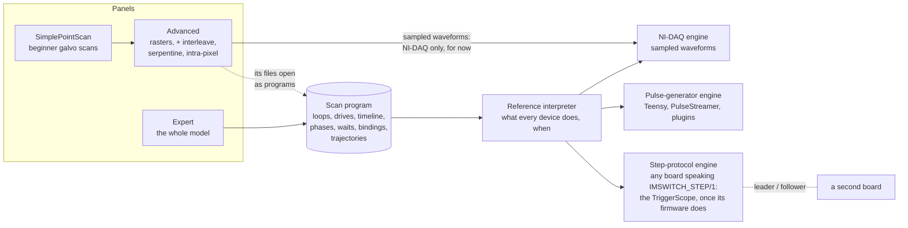

# Scan engines and the Expert scan: what the branch does, and the way to our rigs

Branch `feat/scan-engines`, 12 commits on `main` (240 files, about 38 000
lines, most of them tests). The detail is in `scan-engines-and-expert-scan.md`
(the plan, with a status section per milestone) and what to try on hardware
in `scan-engines-rig-test-plan.md`. This page is the overview.

## The problem it solves

Before this branch, "a scan" meant NI-DAQ waveforms. Every scan panel built
sampled signals for the NI-DAQ, and a scan the panel's fixed geometry could
not express could not be run. The TriggerScope had its own world: six fixed
firmware routines (pLS-RESOLFT, multicolor, LS-XY-RESOLFT, raster, ...), each
with its own panel and its own idea of timing. A Teensy was reachable only
from the widgets written for it. Nothing could say, before a run, what a
given rig can actually play -- a laser on the wrong line simply never fired.

## What it is now: one model, engines that run it, panels that edit it

**The scan program** (`imswitch/imcontrol/model/scan_program/`) describes a
scan independently of any hardware:

- **loops** (outermost first) are separate from the **devices** they drive.
  A device's position is an offset plus µm per count of each loop, or a
  table. That one idea makes interleaving (MS-RESOLFT's cycles x planes),
  composite axes and serpentine ordinary values, not special features;
- a **timeline inside every step**: TTL windows, camera exposures, laser
  power levels, short positioner moves;
- **phases** (line steps at any loop level), **waits** (a pause, or an
  external trigger, with each device's preparation after it), **detector
  bindings** (what each detector records), and **trajectories** (a circle,
  spiral, Lissajous figure, list of points, or a Python path) instead of
  loops;
- a named, versioned **timing policy**. `strict-v1`, the default, plays
  every time exactly or refuses with the representable neighbours ("18 µs is
  not on the 10 µs grid: 10 or 20 µs"). `advanced-compatible-v1` keeps the
  Advanced panel's behaviour and lists everything it plays differently.

**One meaning, many executors.** A reference interpreter turns a program into
the exact timeline of every device. It produces the NI-DAQ's waveforms,
simulates every mock setup, and is the oracle a firmware is checked against.
What a run realizes -- the grid, every time that plays differently, the
approach at the start -- is shown before the run and written into the file
(`ScanStage:scan_schedule`, beside `ScanStage:scan_program`).

**Engines** are a device-plugin kind (`scan_engine`), so anyone can connect
a board:

| Engine | Runs | Typical hardware |
|---|---|---|
| `NidaqScanEngine` | Sampled waveforms: galvo (swept) scans, stepped scans, trajectories, point detectors (APD, PMT) | The NI-DAQ, as before |
| `PulseGeneratorScanEngine` | The digital part of a program as a step table: lasers and cameras with pauses | Teensy, Pulse Streamer, a pulse-generator plugin |
| `StepProtocolScanEngine` | Whole programs on the board itself, over a published serial protocol: DAC steps, TTL windows, waits and triggers, stop, a log of what it executed | The TriggerScope once its firmware speaks `IMSWITCH_STEP/1`; any Arduino-class board |
| Leader and followers | One program across several boards, the followers stepped by the leader's pulses | A TriggerScope plus a second board |

Every engine **declares what it can do** (its timing grid, channels, ranges,
trigger latency, capacity). Compiling a program for an engine gives a
**feasibility report**: every feature native, emulated with its cost,
impossible with the reason and the remedy, or unknown when a number was
never declared -- never guessed. The panels grey out from that report and the
run refuses from it: one authority. **Hardware → What this setup can scan…**
shows the report for the whole setup before anyone builds a scan.

**Which engine runs a scan:** every channel belongs to one engine. An Expert
program runs on the engine its devices are wired to (the leader with its
followers when it spans them); the Advanced and SimplePointScan panels run on
the setup's `scan.engine`.

## The panels

- **SimplePointScan** -- a beginner's galvo point-scanning page (overview,
  draw a region, acquire) laid over the real Advanced panel, with a switch
  back to it. Its mock setup is what a new installation starts with.
- **Advanced** -- as before, plus: serpentine and interleaved axis order on
  stepped (Beta) scans, intra-pixel positioner moves (Guillaume's line
  program, which never played before), greyed-out TTL devices the engine
  does not drive, a timing note of everything that plays differently, a
  progress bar.
- **Expert** (`scanWidgetType: "Expert"`) -- the whole program as tables:
  Loops, Drives, Timeline, Waits, Detectors. **Make…** builds a program from
  a preset -- MS-RESOLFT (cycles x planes), a pulse sequence (widefield
  RESOLFT), a stepped raster, the trajectories, and drop-in patterns from
  `ImSwitchConfig/scan_patterns` -- and reopens with its values. Under the
  tables, the engine's report; **Plot** draws every device's trace. Programs
  save as `scan-program/1` files; an Advanced scan file opens as the program
  it is.

## Around the scan

- **Recording knows what it recorded.** A camera's layout comes from the
  program and its binding, so an MS-RESOLFT recording reads back at its
  positions and SNOUTY restacks it. A camera's binding is checked against
  its trigger line before the run. A trajectory records its gridded image,
  the coverage per bin, and on request every raw measurement with its time
  and position.
- **Event-started scans.** EtSnouty's **Slow scan** can run the Expert
  program once per detected event, on whatever engine runs it; the file
  carries the event that started it.
- **Safety and honesty.** TTL polarity per device (`ttlActiveLevel`); every
  line and DAC at its safe level after a run, a stop or a failure; positioners
  told where a run left them; a timed pause holds every drive where it is;
  a Python trajectory in a file runs
  only once approved on this computer; nothing without a declared number
  (`conversionFactor`, ranges, latencies) is guessed.

**How it was checked.** Built in milestones M0-M6, each with its acceptance
tests (the Beta and Advanced TTL designers reproduced to the sample).
Reviewed by two independent reviewers: about thirty findings, seven high,
all fixed, every fix's test shown to fail without it. Step boards are
checked by a conformance suite against the interpreter, including trigger
handling against independently chosen trigger arrivals. The unit lane
passes (5 052 tests). **Not yet on hardware** -- that is the rig test plan.

## What we can do now

| Rig | Now |
|---|---|
| **NI-DAQ rigs** (STED galvo, MoNaLISA Beta) | Everything as before; in Advanced also interleaved and serpentine orders and intra-pixel moves; in Expert, MS-RESOLFT on a stage, pulse sequences, rasters, and trajectories measured by APDs and PMTs |
| **NI-DAQ plus a Teensy** | A pulse program for the Teensy's lasers runs on the Teensy from the Expert panel, no setup change; the NI-DAQ keeps running its own scans |
| **TriggerScope rigs** (Snouty) | Nothing new on the hardware until the firmware speaks the protocol. Everything else can be prepared now: the setup, the programs, the report, the plot and the recording layout, on a simulated TriggerScope (`"port": "simulated"`) |
| **No hardware** | `expert_mock_scan_setup.json` (Expert on a simulated NI-DAQ), `expert_step_boards_mock_setup.json` (two simulated boards, leader and follower), `simple_mock_setup.json` |

**Not built yet** -- each refused with the reason, never approximated:

- the Advanced and SimplePointScan panels on a board (they build NI-DAQ
  waveforms; a stepped Advanced scan reaches a board through Expert);
- one program across the NI-DAQ and a pulse generator or board (the NI-DAQ
  cannot lead, a pulse generator cannot follow step by step);
- stopping an NI-DAQ iteration midway, and streaming very long programs in
  chunks;
- point detectors on a board, over an event's window, or per phase;
  interleaved orders on galvo (swept) axes; trajectories on a board;
- presets for the TriggerScope's other routines (pLS-RESOLFT, multicolor,
  LS-XY-RESOLFT, raster, galvo detection, light-sheet multicolor).

## The way to our rigs

The goal: the scan module of ImSwitch becomes the one way to scan on every
rig, and the per-routine TriggerScope panels retire.

**Step 1 -- merge without changing anyone's day.** Run P0 of the rig test
plan (the existing Advanced and SimplePointScan scans unchanged, recordings
intact). Existing setups keep their panels; nothing switches by itself.

**Step 2 -- NI-DAQ rigs try the new features.** Interleave and serpentine in
Advanced; Expert on a copy of the setup (`scanWidgetType: "Expert"`) for
MS-RESOLFT on a stage and trajectories. Declare what the new engines ask for
(each positioner's `conversionFactor`, inverted lines' `ttlActiveLevel`,
cameras' `preparation` where a wait precedes them); the Expert report and
**What this setup can scan…** say what is missing. Record, reconstruct, compare with today.

**Step 3 -- the TriggerScope speaks the protocol.** The lab implements
`IMSWITCH_STEP/1` in the TriggerScope firmware: the spec is
`docs/devices/step-engine-protocol.rst` (its worked example is an MS-RESOLFT
scan), the simulated board is the reference implementation, and
`tools/step_board_conformance.py --port COMx --trigger` checks the firmware
program by program against the interpreter. The old commands can stay in
the firmware alongside during the switch.

**Step 4 -- a TriggerScope rig moves over.** In the setup: the TriggerScope
as a `StepProtocolScanEngine` (its port), devices on `triggerscope/dac…` and
`triggerscope/ttl…`, manual control through `StepBoardPositionerManager` and
`StepBoardLaserManager`, `scanWidgetType: "Expert"`; EtSnouty's Slow scan
set to `Scan`. Each scan type the rig uses is written as an Expert program --
MS-RESOLFT is a preset already; the others get a preset each after checking
the model covers them. Run old and new side by side on the same sample,
compare the recordings, then retire that rig's old panels.

**Step 5 -- what ImSwitch adds next, when a rig needs it.**

- the Advanced panel on a board, so the everyday raster panel runs on a
  TriggerScope too;
- the NI-DAQ and a board or pulse generator in one program (the NI-DAQ
  leading, or a shared start or clock), for rigs wired across both;
- stopping an NI-DAQ scan midway; chunked streaming for long programs;
- point detectors on a board, if a TriggerScope rig needs APDs.

**Decisions for us:** which rig goes first (Snouty, with the TriggerScope, is
the natural one: it is what the Expert panel and the protocol were designed
around), who writes the firmware and when, and which of step 5 we need first.
