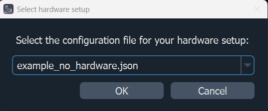
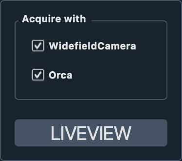
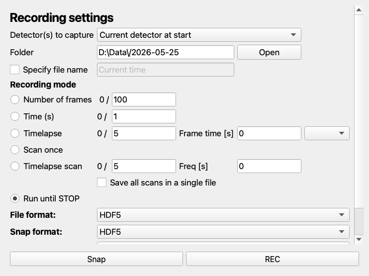

**************************************
Your first image, without a microscope
**************************************

From a fresh install to a live image and a saved recording, using the
simulated setup ImSwitch2 ships for this.  Nothing needs to be connected.
It takes about five minutes; read :doc:`essentials` first if you have not.

1. Start ImSwitch2
==================

Run ``imswitch`` (or ``python -m imswitch``), or open the installed
application.  The first start takes a minute: ImSwitch2 creates its
``ImSwitchConfig`` folder and copies the example setups into it.

2. Pick the simulated setup
===========================

The **Select hardware setup** dialog opens with ``example_no_hardware.json``
already selected.  Keep it and click **OK**.

This setup simulates two cameras (*Mock Camera* and *Mock ThorCam TSI*),
stages, rotation mounts, a power meter and a polarimeter.  The picker does not
appear again: next time ImSwitch2 starts on the same setup.  To change it,
use **Hardware > Pick hardware setup…** (ImSwitch2 restarts).

3. Start the live view
======================

The window opens on the **Hardware Control** tab.  The large area is the
**Image Display**; the panels around it are the ones this setup asks for.

In the **Image Controls** panel, the cameras ticked under *Acquire with*
are the ones that stream.  Click **LIVEVIEW** (or press :kbd:`Ctrl+L`).
Each ticked camera appears as an image layer in the Image Display and
updates continuously with simulated frames.

The **Detector Settings** panel sets exposure, gain and region of interest
of the camera chosen under *Current detector* at its top; that camera is
also the one *Snap* and *REC* use below.

4. Save one image
=================

In the **Recording** panel, click **Snap**.  One image of the current
camera is written to the folder shown under *Folder*: by default
``ImSwitchConfig/recordings/<today's date>`` in your home folder (Documents
on Windows), named after the time, for example
``14h02m11s_snap_Mock Camera.h5``.  **Open** next to the folder shows it in
your file browser.

Further down the panel, *File format* and *Snap format* choose HDF5,
TIFF or Zarr; HDF5 is the default.

5. Record a short series
========================

Still in the **Recording** panel:

#. Under *Recording mode*, click **Number of frames** and type ``20``.
#. Click **REC**.  The button stays pressed while it records and releases
   by itself after the 20th frame.

The recording lands in the same folder, for example
``14h02m30s_rec_Mock Camera.hdf5``, holding a stack of 20 frames.  The
default mode, *Run until STOP*, records until you click **REC** again.

6. Where next
=============

* Open the recording in the **Image Processing** tab: :doc:`improcess`.
* Every panel and menu of Hardware Control: :doc:`imcontrol`.
* Do the same from a script: the :doc:`tutorials` start with exactly this
  (snap, then record) on a single simulated camera.
* Describe your own microscope: :doc:`imcontrol-setups`.
