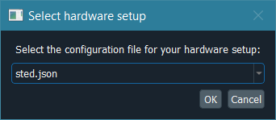
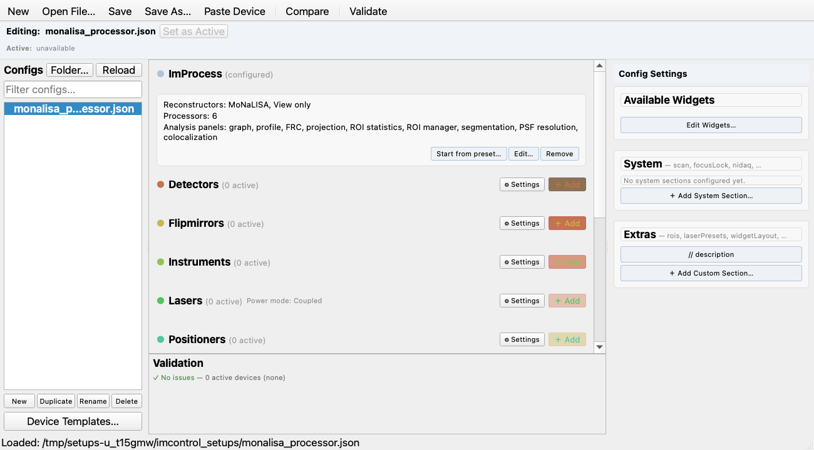
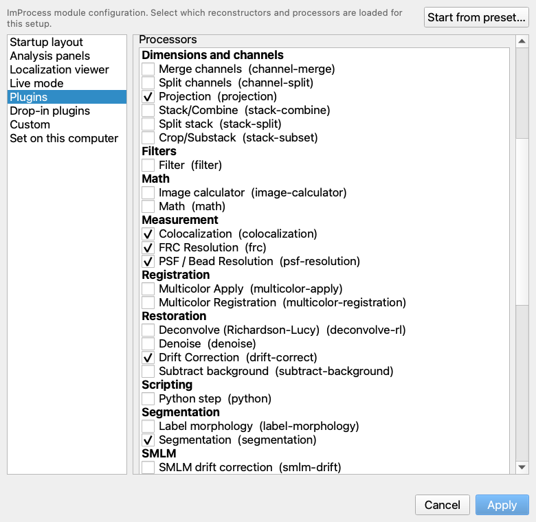

*******************************
Hardware control configurations
*******************************

ImSwitch2's hardware control module is designed to be flexible and
usable in a wide variety of microscopy setups.  In order to provide
this flexibility, hardware configurations are defined in JSON files
that are loaded when the hardware control module starts.

Setup files are loaded from the ``imcontrol_setups`` directory,
created inside your user config directory the first time the hardware
control module starts.  It is pre-populated with example setups.
The user directory is:

* ``%USERPROFILE%\Documents\ImSwitchConfig\`` on Windows
* ``~/ImSwitchConfig/`` on macOS / Linux

The first time you start the hardware control module you will be
prompted to select a setup file.  To switch later, use
**Hardware → Pick hardware setup…** in the menu bar.

The choice is stored as ``setupFileName`` in
``ImSwitchConfig/config/imcontrol_options.json``; the prompt appears when
that file does not exist yet, or when the setup it names is missing.  The same
file holds the per-computer settings that are not part of any setup:

* ``recording.outputFolder`` and ``recording.includeDateInOutputFolder``:
  where recordings are saved, and whether a dated subfolder is added
  (default ``ImSwitchConfig/recordings``, with date), editable with
  **Preferences → Recordings folder…**
* ``watcher.outputFolder``: the folder the **Watcher** panel starts on
  (default ``ImSwitchConfig/scripts``)
* ``memory.writerQueueMB`` (512), ``memory.perDetectorQueueMB`` (256) and
  ``memory.processingWorkingSetMB`` (1024): memory limits in MiB, editable
  with **Preferences → Memory limits…** (see :ref:`improcess-memory-limits`)

.. tip::

   Don't want to hand-edit JSON?  Use the bundled visual setup editor.
   It shows typed fields for every manager's ``managerProperties`` and for
   the sections of the file that are not devices (:ref:`config-editor-system-sections`,
   :ref:`config-editor-improcess`).

   From a running ImSwitch2, open it with
   **Hardware → Edit hardware configuration…**.  It opens on the setup file
   this session is running and does not block the rest of the GUI, so the
   microscope stays usable while you edit.

   Without starting the microscope, from a source checkout:

   .. code-block:: bash

      python utility_scripts/imswitch_config_editor.py

   or from an installed copy:

   .. code-block:: bash

      python -c "from imswitch.imcontrol.view.configeditor import main; main()"

   To check a setup file for unknown managers and deprecated sections
   without starting anything:

   .. code-block:: bash

      python -m imswitch.imcontrol.model.plugins validate-setup my_setup.json

.. note::

   The hardware configuration is read once, when ImSwitch2 starts; there is
   no way to apply a changed setup file to a running session.  When you
   close the editor after saving changes to the setup this session is
   running — or after pressing **Set as Active Config** — ImSwitch2 offers
   to restart.  Accepting shuts the session down normally (widget states
   saved, hardware finalized) and then comes back up on the new
   configuration; it is not a forced relaunch that leaves devices as they
   stood.

   Editing some *other* setup file changes nothing about the running
   session, so nothing is asked.

.. _config-editor-system-sections:

System sections in the config editor
====================================

The **System** card lists the sections of the setup file that configure
ImSwitch2 rather than one device: ``scan``, ``focusLock``, ``autofocus``,
``tiling``, ``nidaq``, ``etSTED``, ``microscopeStand``, ``teensyPulse``,
``triggerScope``, ``pyroServerInfo`` and the legacy ``pulseStreamer``.  Each
configured section has an **Edit…** button and a **×** that removes it, and
**＋ Add System Section…** offers the ones the file does not have.  The
ImProcess block has its own place on the canvas
(:ref:`below <config-editor-improcess>`) and follows the same rules.
``triggerScope`` is a System section too; it used to appear under **Extras**
as raw JSON.

The dialog has one tab per group of options, each option with its explanation
as a tooltip.  ``focusLock`` has the tabs Devices, Basic, Crop, Control and
Reacquire; ``autofocus`` has Devices, Basic, Crop and Advanced; ``tiling`` has
Devices, Basic, Acquisition, Saving and Mosaic; ``scan`` has Basic, Designers
and DAQ clocks; ``teensyPulse`` has Basic and Advanced.  Choices the code defines are drop-downs: the tiling **Default pattern**
(spiral or serpentine), **Mode** and **Save format**, for example.  Rates are
in the unit the code reads: the ``focusLock`` and ``autofocus`` **Update
freq** is in hertz.

**Apply writes the section as the file had it**, for every System section.  A
key is written only if

* the file already had it,
* you changed it in the dialog, or
* the setup loader needs it.

A short section therefore stays short: opening a section and pressing
**Apply** changes nothing, a key you did not touch is neither added nor
changed, and keys come back in the order the file had them.  A key the file
leaves out shows the value the code uses for it; it is written only once you
change it.

A key is *needed by the loader* when leaving it out makes the setup loader
fail, or warn that it defaulted the value to ``null``.  Those keys are marked
with a bold label and an asterisk.  ``focusLock`` needs ``camera``,
``positioner``, ``updateFreq``, the four crop values, ``piKp`` and ``piKi``;
``autofocus`` needs the same camera, positioner, update frequency and four
crop values (no PI gains); ``scan`` needs the widget type, both designers and
their parameter dicts (``{}`` for none) and the sample rate; ``tiling`` needs
``xyPositioner``; ``triggerScope`` needs ``rs232device``; ``microscopeStand``
needs ``managerName`` and ``rs232device``.  ``nidaq``, ``etSTED``,
``teensyPulse``, ``pyroServerInfo`` and ``pulseStreamer`` need nothing.

Keys the editor has no field for stay on the **Custom** tab and are written
back unchanged; **⊕ Add property** adds your own.  A key a newer ImSwitch
wrote, or one only your site reads, survives an Edit and Apply.

**A new section starts with its required keys only, and they are empty.**
The editor does not fill in a number the code has no default for (a crop
width, a PI gain, a sample rate) or a class name: you choose it.  **Apply**
refuses and lists what is missing (``Missing required: Detector, Z
Positioner, …``) until each is filled in.  The same holds when you edit a
section whose file lacks a required key: it shows empty and must be filled
before Apply.  A section with nothing required starts as an empty block, and
is listed on the card once it holds a key.

.. _config-editor-improcess:

ImProcess settings in the config editor
=======================================

The setup file's ``processing`` block (which ImProcess panels open at
startup, which reconstructors and processors it offers, the live-mode
settings) has its own section on the editor's centre canvas, headed
**ImProcess**.  It is always shown, below the device categories, and first
for a setup with no devices at all, such as the processor-only presets.  The
card under the heading says what the block does: the reconstructors by name,
with the first marked as the one that starts active (``Reconstructors:
MoNaLISA (starts active), View only``), how many processors, which analysis
panels open, any live-mode setting that differs from its default and how many
keys the editor has no field for.  With no ``processing`` block it says which
standalone defaults ImProcess then uses.

The card has three buttons:

* **Configure…** (**Edit…** once the setup has a block) opens the ImProcess
  dialog.
* **Start from preset…** lists the processor-only setups ImSwitch ships by
  title.  For the selected one it shows what it is for and what it sets,
  read in words and not as JSON: its reconstructors and processors by name
  (the reconstructors with their one-line descriptions, the processors under
  their categories), what **Opens at startup**, what is **Hidden at startup**
  and any **Other settings**.  The first reconstructor is marked *starts
  active*, as on the card.  A part the preset leaves at its default is not
  mentioned.  Ten presets ship, listed with their titles in
  :ref:`improcess-processing-presets`, which also says how a setup file
  becomes one.  **Use preset** copies the chosen block into this setup
  (:ref:`improcess-processing-presets`); the preset file itself is not
  changed.  If the setup already has a block you are asked before it is
  replaced.  The dialog has the same button, which replaces what the dialog
  shows; nothing is written until you press **Apply**.

  .. image:: ./images/config-editor-improcess-presets.png
     :alt: The Start from preset window with the MoNaLISA reconstruction preset selected: its description, its reconstructors with their descriptions and the first marked starts active, its processors by category and the panels it opens
     :align: center
* **Remove** deletes the ``processing`` block from the setup, after asking.

The reconstructors and the processors are the main components of ImProcess,
so they are the dialog's first two pages, and it opens on the first.  Every
other group of options is a page after them, each option with its
one-sentence explanation under it, and three pages are not options:

* **Reconstructors**: the built-in reconstructors to register, one row each
  with its name, its id (muted) and a one-line description; at least one is
  required.  Above the rows, **Starts with** chooses the reconstructor ImProcess
  has selected when it opens; the others stay available in the Parameters
  dock's picker.  The combo lists the ticked reconstructors by name and
  follows the ticks: ticking one adds it at the end, unticking removes it, and
  when the chosen one is unticked the first remaining one is chosen.  There is
  no setting for the choice: ImProcess opens on the **first reconstructor the
  setup lists**, so the editor writes the chosen one first.  Ticking another
  one keeps the order the file had and adds the new one after it; nothing is
  reordered until you tick, untick or choose.  An id the file has that this
  computer does not (listed under *Not known here*) can be chosen too.
* **Processors**: the built-in processors to register, in the same rows,
  grouped under their categories.  An id in the file that this computer does
  not know is listed under *Not known here (kept as written)* and kept.
* **Drop-in plugins**: what the plugins folder holds on this computer
  (id, kind, name, file), with a **Rescan** button; read-only.  A drop-in
  plugin is active on a computer whenever its file is in the plugins folder,
  so it does not belong in the setup: an id listed there only makes the setup
  look for a file that other computers may not have.  Listed drop-in ids are
  marked on this page.  The folder is scanned by importing the plugin files,
  so this happens when the dialog opens (once per editor session), not when
  the editor starts; a file that fails to load is shown with the reason.
* **Startup layout**: which ImProcess docks open at startup.
* **Analysis panels**: the optional panels that are closed unless switched on.
* **Localization viewer**: the point-cloud rendering of localization results.
* **Live mode**: the stall timeout, the viewer refresh interval and whether
  live results also appear in ImControl.
* **napari plugins**: the napari plugin endpoints, a JSON list in a text
  box; a list that is not valid JSON, or an entry that is not a valid
  endpoint, is reported when you press **Apply**, which stays on that page
  until it is fixed.
* **Custom**: keys in the block that the editor has no field for, kept as
  they are, and **⊕ Add property** for your own.
* **Set on this computer**: the ImProcess settings that are *not* in a setup
  (below).

**Apply** writes the block as the file had it, by the rule in
:ref:`config-editor-system-sections`.  The one required key is the list of
reconstructors, which may not be empty.  Keys the editor does not know stay on
the Custom page.  The key reference is in :ref:`the processing section
<setupinfo-processing>` of the setup reference.

The editor's validation panel checks the plugin lists against what exists:

* a reconstructor or processor id that is neither built in nor a drop-in on
  this computer is an **error** (``processing.reconstructors contains unknown
  plugin ID(s)``): ImProcess skips such an id at startup and starts with the
  rest;
* a drop-in plugin's id listed in the setup is a **warning**, for the reason
  above;
* ``reconstructors`` that is not a list, or is empty, is an error.

Some ImProcess settings belong to a computer, not to a setup, and are neither
in this dialog nor in the setup file.  They are set inside ImProcess and kept
in ``ImSwitchConfig/config/improcess_options.json``:

* the Fiji location: **Plugins → Fiji → Fiji location…**
* the image display (embedded napari viewer or separate windows):
  **Preferences → Image display**
* the default data and save folders: **Preferences → Default folders…**

How configurations are defined
==============================

Configurations are JSON.  Internally they are deserialized into Python
class instances (one per device type) when loaded.

A central concept in ImSwitch2 is the **device manager**.  A device
manager defines what kind of device you have and how ImSwitch2
communicates with it.  For example, to control a Hamamatsu camera you
declare a detector whose ``managerName`` is ``"HamamatsuManager"`` and
fill in its ``managerProperties``.  Each device must have a unique
name, given by its key in the JSON object.

The **complete per-manager reference** — every field, every default,
every required low-level dependency — lives in the per-category pages
under :doc:`devices/ <devices/detectors>`:

* :doc:`devices/detectors` — every ``DetectorManager``.
* :doc:`devices/lasers` — every ``LaserManager``.
* :doc:`devices/positioners` — every ``PositionerManager``.
* :doc:`devices/rotators` — every ``RotatorManager``.
* :doc:`devices/stands` — microscope stand integrations configured through ``microscopeStand``.

Some managers are not built in but come from separately installed device
plugins, and are named by an id such as ``"tis.camera-ic4"`` or
``"zhinst.lockin-demod"``; see :doc:`devices/plugins`.

For adding a *new* manager class (i.e. implementing one yourself), see
:doc:`adding-device-support`.

**Signal designers** — used when you build a scan — are similar.  In a
point-scanning setup, for example, you might select
``PointScanTTLCycleDesigner`` to generate the TTL signals for your
scan.  They are documented :ref:`below <signal-designers>`.

Minimal example: a single Cobolt 06-01 laser on COM11:

.. code-block:: json

   {
       "lasers": {
           "Cobolt405nm": {
               "managerName": "Cobolt0601LaserManager",
               "managerProperties": {
                   "digitalPorts": ["COM11"]
               },
               "valueRangeMin": 0,
               "valueRangeMax": 200,
               "wavelength": 405
           }
       },
       "availableWidgets": [
           "Laser"
       ]
   }

``digitalPorts`` is a property specific to ``Cobolt0601LaserManager``
— each manager defines its own keys.

Setup file specification
========================

Top-level shape:

.. autoclassconheader:: imswitch.imcontrol.view.guitools.ViewSetupInfo.ViewSetupInfo
   :no-index:
   :members:
   :inherited-members:

Per-device info classes
=======================

These ``Info`` classes describe the *generic* fields every entry in
the corresponding top-level dict accepts.  Manager-specific keys go
inside ``managerProperties`` and are documented in the per-category
pages linked above.

.. autoclassconheader:: imswitch.imcontrol.model.SetupInfo.DeviceInfo
   :members:

.. autoclassconheader:: imswitch.imcontrol.model.SetupInfo.DetectorInfo
   :members:
   :inherited-members:

.. autoclassconheader:: imswitch.imcontrol.model.SetupInfo.LaserInfo
   :members:
   :inherited-members:

.. autoclassconheader:: imswitch.imcontrol.model.SetupInfo.PositionerInfo
   :members:
   :inherited-members:

.. autoclassconheader:: imswitch.imcontrol.model.SetupInfo.RS232Info
   :members:
   :inherited-members:

.. autoclassconheader:: imswitch.imcontrol.model.SetupInfo.SLMInfo
   :members:
   :inherited-members:

.. autoclassconheader:: imswitch.imcontrol.model.SetupInfo.FocusLockInfo
   :members:
   :inherited-members:

.. autoclassconheader:: imswitch.imcontrol.model.SetupInfo.ScanInfo
   :members:
   :inherited-members:

.. autoclassconheader:: imswitch.imcontrol.model.SetupInfo.NidaqInfo
   :members:
   :inherited-members:

.. autoclassconheader:: imswitch.imcontrol.model.SetupInfo.SLMsInfo
   :members:
   :inherited-members:
   :exclude-members: wavelengthTableFile

.. autoclassconheader:: imswitch.imcontrol.model.SetupInfo.AutofocusInfo
   :members:

.. autoclassconheader:: imswitch.imcontrol.model.SetupInfo.TilingInfo
   :members:

.. autoclassconheader:: imswitch.imcontrol.model.SetupInfo.EtSTEDInfo
   :members:

.. autoclassconheader:: imswitch.imcontrol.model.SetupInfo.MicroscopeStandInfo
   :members:

.. autoclassconheader:: imswitch.imcontrol.model.SetupInfo.FlipMirrorInfo
   :members:

.. autoclassconheader:: imswitch.imcontrol.model.SetupInfo.TriggerScopeInfo
   :members:

.. autoclassconheader:: imswitch.imcontrol.model.SetupInfo.TeensyPulseInfo
   :members:

.. autoclassconheader:: imswitch.imcontrol.model.SetupInfo.PyroServerInfo
   :members:

.. autoclassconheader:: imswitch.imcontrol.model.SetupInfo.PulseStreamerInfo
   :members:

.. autoclassconheader:: imswitch.imcontrol.view.guitools.ViewSetupInfo.WidgetLayoutInfo
   :members:

.. autoclassconheader:: imswitch.imcontrol.view.guitools.ViewSetupInfo.ROIInfo
   :members:
   :inherited-members:

.. autoclassconheader:: imswitch.imcontrol.view.guitools.ViewSetupInfo.LaserPresetInfo
   :members:
   :inherited-members:

.. _Signal designers:

.. _signal-designers:

Signal designers
================

Signal designers translate high-level scan settings into the
analog/digital waveforms that drive scanners and modulate lasers.
They are selected via the ``scanDesigner`` / ``TTLCycleDesigner`` fields
of the ``scan`` section in your setup file, and each pair has to match the
``scanWidgetType`` (see :ref:`setupinfo-scan`).

Scan designers
--------------

.. autoclassconheader:: imswitch.imcontrol.model.signaldesigners.BetaScanDesigner.BetaScanDesigner

.. autoclassconheader:: imswitch.imcontrol.model.signaldesigners.GalvoScanDesigner.GalvoScanDesigner

TTL cycle designers
-------------------

.. autoclassconheader:: imswitch.imcontrol.model.signaldesigners.BetaTTLCycleDesigner.BetaTTLCycleDesigner

.. autoclassconheader:: imswitch.imcontrol.model.signaldesigners.PointScanTTLCycleDesigner.PointScanTTLCycleDesigner

.. autoclassconheader:: imswitch.imcontrol.model.signaldesigners.AdvancedScanTTLCycleDesigner.AdvancedScanTTLCycleDesigner
